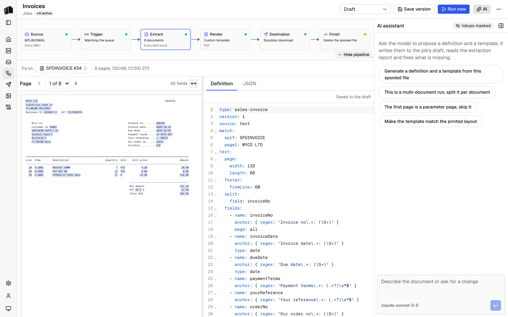

The AI assistant sits beside the workbench in the job builder. Ask it for a
definition and it reads the sample pages, writes the YAML to the job's
draft, reads the extraction report, fixes missing fields, then writes a
template and renders it: HTML, or a Word template it designs or edits. The page view, the JSON and the preview update as
it works, and everything it writes can be edited by hand. Without a model
set, the job builder works as before and the assistant points to Settings.

  <picture>
    <source media="(prefers-color-scheme: dark)" srcset="assets/ai-assistant-dark.png">
    
  </picture>

## Choosing a model

Under Settings, AI model, with no restart:

| Setting | What it is |
|---------|------------|
| Provider | Anthropic, Google, OpenAI, OpenRouter, Vercel AI Gateway, or a local model behind an OpenAI-compatible endpoint (Ollama, LM Studio, vLLM) with its base URL. |
| API key | The provider's key, stored encrypted. Optional for a local model. |
| Model | One of the suggested models, or any model id the provider offers. |
| Effort | How much the model reasons before it answers, from None to Max, or the provider's default. Models that do not reason ignore it. |

Each provider keeps its own key, model and effort, so switching back is
one click. None (chat off) turns the assistant off and keeps every
provider's settings. Any signed-in user can set or replace a key, but no
request can read one back.

## What it can do

The assistant works through twelve tools: nine on the job's draft and its
preview sample, two that read other jobs' files, and one that reads the
Carbone syntax reference:

| Tool | What it does |
|------|--------------|
| `read_sample_page` | Reads one page of the sample as numbered lines. The first three pages are in its instructions already. |
| `write_definition` | Saves the definition YAML to the draft, runs the extraction on the sample and returns the report: documents found, each field with its status, missing fields, warnings and the first document as JSON. |
| `write_template` | Saves the HTML template of one [output](jobs.md#outputs), the first unless it names another, checks it, renders the first document with Carbone and returns any errors, by line, and its visible text. Without a working Carbone server it only checks. It refuses an output with a Word template. |
| `write_word_template` | Designs a [Word template](templates.md#word-templates) for one output and saves it as a new file the output uses. Returns what the check and Carbone find, the text of the first document and, for models that take files, the document itself. |
| `read_word_template` | Lists the parts of an output's Word template (the body, headers and footers), or reads one part's XML. |
| `edit_word_template` | Changes an output's Word template, yours or the starter template, by replacing text in its XML, and saves the result as a new file. Returns what `write_word_template` returns. |
| `render_preview` | Renders a document with one output's template, HTML or Word, again after a change to the definition, and returns what the check finds and the visible text. For a Word template it also shows models that take files the document. |
| `add_output` | Adds an output with an HTML or Word template, a name and formats. It uses the starter template until the assistant writes one. |
| `remove_output` | Removes an output and its template. The last output cannot be removed. |
| `list_jobs` | Lists the other jobs with their definition type, outputs and whether they have a template. |
| `read_job_files` | Reads another job's definition YAML and the template HTML of each of its outputs, from its active version or else its draft, so a new job can start from them. |
| `read_carbone_reference` | Reads one reference file of the Carbone syntax reference, such as the list of formatters. |

The model adds or removes outputs only when you ask for it. It uses the
last two tools only when you ask it to start from or reuse another job ("start from the Invoices job's template"); it adapts what it
takes to the sample and saves it with the write tools. The same copy
without a model is "Start from job" in the template editor's bar.

No tool reaches the IBM i, the job log or any other spooled file, and
nothing it writes is a version: save one yourself when the result is
right.

## Word templates

Ask for a Word template ("make a Word invoice with our logo, in dark
blue") and the assistant designs one: page size and margins, headers and
footers, a different first page, named styles, fonts, colours, spacing,
borders, shaded table rows, merged cells, page numbers and the PNG and
JPEG images uploaded under Assets. It then renders the first document and
looks at the result, and changes the design until it reads well.
Its instructions include guidance on document design: a clear order of
importance, whitespace, one accent colour, right-aligned amounts, and
layouts that still read when printed in black and white.

It writes the design as data, in the shape of the
[docx](https://docx.js.org) library's options, and Spooldoc builds the
`.docx` from it. Only the parts of the library listed in
[templates](templates.md#word-templates-by-the-assistant) are allowed, and
no code the model writes runs on the server.

To change a Word template you made yourself, it edits the file instead of
designing a new one, so everything else in it stays as you made it: it
reads the XML of the body, a header or a footer and replaces the text it
needs to. Text Word split over several runs with the same formatting is
joined first, so a tag can be found. An edit that would break the file is
refused, and nothing is saved.

**What it looks at.** After each design or edit the assistant gets the
first document as it prints, as a PDF of every page made the way a run
makes it. The first page of a document often differs from the rest, with
the letterhead and the address on page 1 and the running header,
continued table and totals after it, so it checks them all. A document of
more than five pages comes as a picture of page 1, with a note to check
the later pages on a shorter document. The model gets the file in the
next steps of the answer it is working on, not again later, and the
conversation stores only the text of the result. Models from Anthropic,
OpenAI and Google take files, directly or through OpenRouter and the
Vercel AI Gateway; other models, and a local model, get the text of the
document only. Values in the document are masked when
[masking](#masking) is on. Pictures, such as your logo, are as they are
in the file.

**Nothing is overwritten.** Each design or edit is saved as a new file,
and the output uses it from then on. Your earlier file is kept, and the
Word panel says when the assistant made the current file and offers
**Use previous file**, or **Use starter template** when there was none. A
saved version keeps the file it ran with. The assistant changes an HTML
output to Word only while it still uses the HTML starter template;
otherwise it asks you to switch the output in the render step, or adds a
Word output when you ask for one.

The file is an ordinary Word document: open it in Word, change it and
upload it again, or ask the assistant for the next change.

The assistant writes [Carbone tags](templates.md). Its instructions hold
the [Carbone Skill](https://github.com/carboneio/carbone-skill) by Carbone
(Apache License 2.0) as the syntax reference, and say which Carbone
features the connected server has: on the Community Edition it leaves out
Enterprise features such as `:aggSum`. See [Carbone](carbone.md).

## What it sees

What the model receives:

- The page text of the job's preview sample: the first three pages (up to
  400 lines) in the instructions, any other page on request.
- The sample's metadata: spooled file name, queue, user data, page size
  and code page.
- The job's current definition, its outputs with their formats and
  templates (the text of a Word template, paragraph by paragraph), the
  names of the uploaded assets, and the Carbone edition.
- Tool results: the extraction report and the rendered text, and for a
  Word template, the rendered document (see
  [Word templates](#word-templates)).
- On request, other jobs' definitions and templates: layout, not
  customer data. Nothing else of a job (its server, destination, finish
  settings, runs or samples) is readable.

What it never receives: IBM i credentials, the login session, the IBM i
connection, other spooled files, or the job log.

## The conversation

Each job keeps one conversation with the assistant, stored with the job
and shown again when you come back to the job builder; it is deleted with
the job. New chat in the panel header forgets it and starts another, while
the definition and template it wrote stay in the draft. Only the recent
part of a long conversation goes to the model with each message (the last
20 messages, within a character budget, older tool results dropped first);
the model's instructions carry the current definition, outputs,
templates and sample pages, so nothing it needs is lost. The stored messages hold what
the model saw, except the rendered Word documents: with masking on, the
tool results are masked too.

## Masking

Masking is on by default (`SPOOLDOC_MASK=true`): before page text or a
tool result goes to the model, digits become `9` and letters `X` or `x`,
while labels that repeat across pages, positions and lengths stay as
printed. The model sees the layout, not the customer. The chat panel shows
"Values masked", or "Values sent in clear" with `SPOOLDOC_MASK=false`.
What the model writes, and the job builder itself, use the real values.

A hosted provider processes what it receives under its own terms; a local
model keeps it on your network. A local model's base URL is called by the
server, so only enter one you trust. See [Security](security.md).
