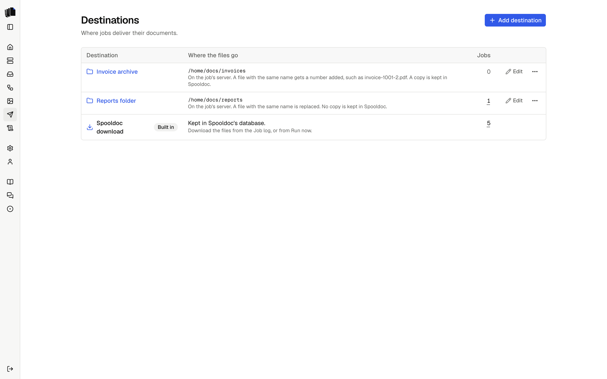
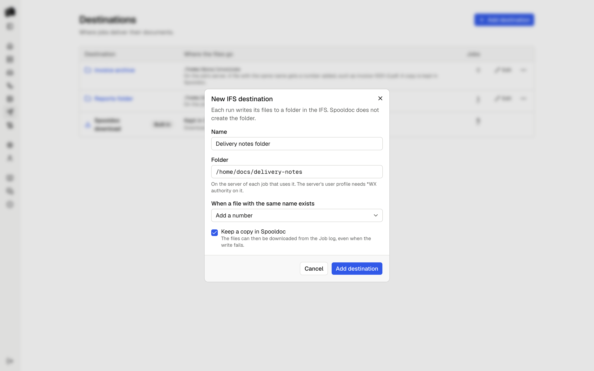

A destination is where the files of a run go. Jobs pick one in the
destination step. The Destinations page lists them with the jobs that use
each, and adds, edits and deletes the ones you made.

<p align="center">
  <picture>
    <source media="(prefers-color-scheme: dark)" srcset="assets/destinations-dark.png">
    
  </picture>
</p>

## Spooldoc download

The built-in destination keeps every file in Spooldoc's database. The
files appear on the run in the [job log](job-log.md), a file per document
in each format of its [template](jobs.md#templates), named after the
definition's `output.name`, and can be downloaded from there. An Excel
template of the whole spooled file makes one file per format for the
spooled file, named after it. They are deleted with the run when it passes the
retention period.

A run's files are saved together or not at all. The spooled file is held,
moved or deleted only after every file was delivered. The built-in
destination cannot be changed or deleted.

## IFS folder

An IFS destination writes each file of a run to a folder in the IFS, where
programs on the IBM i can pick it up. Add one with **Add destination** on
the Destinations page. It has a name, a folder such as `/home/docs/out`,
and two settings.

<p align="center">
  <picture>
    <source media="(prefers-color-scheme: dark)" srcset="assets/destination-ifs-dark.png">
    
  </picture>
</p>

**The folder is on the job's server.** A destination holds a folder, not a
server: each job writes to the folder on the IBM i it reads its spooled
files from. Two jobs on two servers can share one destination.

**Spooldoc never creates the folder.** When it does not exist, the run
fails with "The folder /home/docs/out does not exist on
ibmi.example.com", before any file is written. Create it on the IBM i,
for example with `MKDIR DIR('/home/docs/out')`, or change the folder.

**Authority.** The user profile of the server needs `*WX` data authority
on the folder and `*X` on every folder above it. A security officer can
grant it with:

```
CHGAUT OBJ('/home/docs/out') USER(MYUSER) DTAAUT(*WX)
```

When the authority is missing, the run says which folder and which
authority, and keeps the IBM i's own text under Details.

**CCSID.** Each file is tagged so programs on the IBM i read it right:
HTML and other text with CCSID 1208 (UTF-8), PDF, DOCX and XLSX with
65535 (binary).

**When a file with the same name exists**, the destination does one of
three things:

| Setting | What happens |
|---------|--------------|
| Replace | The old file is replaced. This is the default. |
| Fail the run | The run fails and says which file is in the way. Every name is checked first, so nothing is written. No file is ever replaced, not even one another run writes while this one runs. |
| Add a number | The file gets the first free number: `invoice-1001-2.pdf`, then `invoice-1001-3.pdf`. A name another run takes while this one writes gets the next number. |

Names are checked the way the IBM i compares them. Folders outside
`/QOpenSys` ignore case, so `Acme.pdf` and `ACME.pdf` are one file there.
When two files of one run have names that differ only in case, the second
gets a number, `ACME-2.pdf`, in every setting, so neither replaces the
other. Spooldoc does this in every folder.

**Keep a copy in Spooldoc** is on by default. The files are then also
kept as with [Spooldoc download](#spooldoc-download), and saved before the
write to the IFS, so they can be downloaded from the job log even when the
write fails. With it off, the run's Files section says no copy was kept,
and the Deliver step says where the files went: "Wrote 6 files to
/home/docs/out on ibmi.example.com (1 replaced)".

**A file is never half written.** Each file is written to a part file of
its own first, such as `.invoice-1001.pdf.1a2b3c4d.part`, and renamed when
it is complete, so a program that watches the folder sees whole files
only. Two runs that write the same name at once each have their own part
file. Have the program skip names that start with a dot.

**A replaced file is replaced, not updated in place.** Spooldoc renames
the old file aside, to a name that ends in `.old`, renames the new file
into its place, and then deletes the old one. A program that has the old
file open keeps reading the old file. If the new file cannot take its
place, the old one is renamed back, so a failed write never loses both.
If even that fails, the run says where each file is, and you rename the
one to keep. If the old file cannot be deleted at the end, the Deliver
step names it, and you delete it.

**When a write fails part way**, the run fails with "Wrote 2 of 6 files to
/home/docs/out, then: ..." and the reason. The files already written stay
in the folder. The spooled file is not held, moved or deleted, so after
fixing the problem, [Retry](job-log.md#retry) runs it again. What the
retry does with the files the first try wrote depends on the setting:

| Setting | On retry |
|---------|----------|
| Replace | They are written again under the same names, so the folder holds one copy of each. |
| Fail the run | The retry fails at once, since their names are taken. Move them first. |
| Add a number | They are written again with a number: `invoice-1001-2.pdf` next to `invoice-1001.pdf`. A program that watches the folder takes each document twice. |

Use Replace for jobs you may retry.

A destination that a job's draft or any saved version delivers to cannot
be deleted. Deleting one never touches the folder or its files.

## Writing a destination

A destination is one small interface in
`apps/web/lib/server/destinations`: a kind and a `deliver` call that
receives the run's files. See [Contributing](contributing.md#adding-a-destination).
Planned destinations are listed in the [README](../README.md#status).
