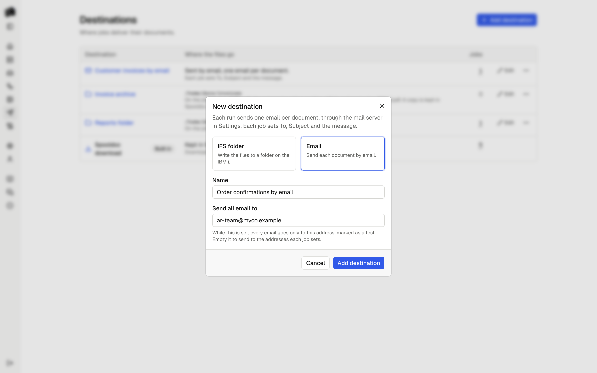
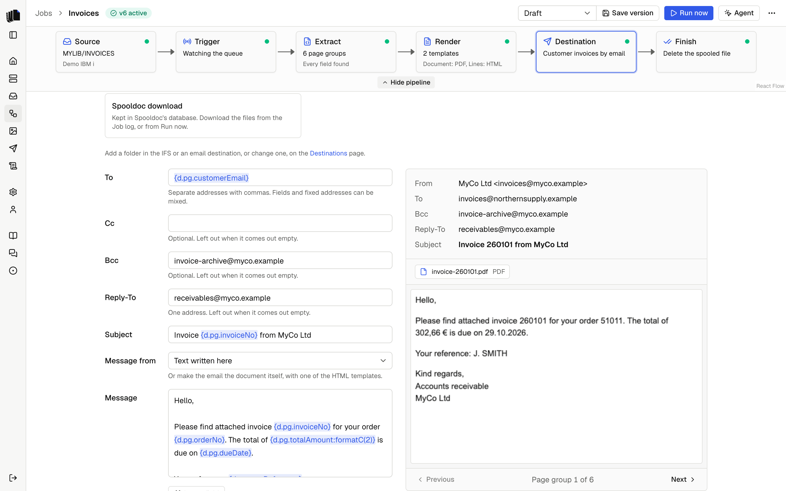

A destination is where the files of a run go. Jobs pick one in the
destination step. The Destinations page lists them with the jobs that use
each, and adds, edits and deletes the ones you made.

<p align="center">
  <picture>
    <source media="(prefers-color-scheme: dark)" srcset="assets/destinations-dark.png">
    
  </picture>
</p>

## Spooldoc download

The built-in destination keeps every file in Spooldoc's database. The
files appear on the run in the [job log](job-log.md), a file per document
in each format of its [template](jobs.md#templates), named after the
definition's `output.name`, and can be downloaded from there. An Excel
template of the whole spooled file makes one file per format for the
spooled file, named after it. They are deleted with the run when it passes the
retention period.

A run's files are saved together or not at all. The spooled file is held,
moved or deleted only after every file was delivered. The built-in
destination cannot be changed or deleted.

## IFS folder

An IFS destination writes each file of a run to a folder in the IFS, where
programs on the IBM i can pick it up. Add one with **Add destination** on
the Destinations page. It has a name, a folder such as `/home/docs/out`,
and two settings.

<p align="center">
  <picture>
    <source media="(prefers-color-scheme: dark)" srcset="assets/destination-ifs-dark.png">
    
  </picture>
</p>

**The folder is on the job's server.** A destination holds a folder, not a
server: each job writes to the folder on the IBM i it reads its spooled
files from. Two jobs on two servers can share one destination.

**Spooldoc never creates the folder.** When it does not exist, the run
fails with "The folder /home/docs/out does not exist on
ibmi.example.com", before any file is written. Create it on the IBM i,
for example with `MKDIR DIR('/home/docs/out')`, or change the folder.

**Authority.** The user profile of the server needs `*WX` data authority
on the folder and `*X` on every folder above it. A security officer can
grant it with:

```
CHGAUT OBJ('/home/docs/out') USER(MYUSER) DTAAUT(*WX)
```

When the authority is missing, the run says which folder and which
authority, and keeps the IBM i's own text under Details.

**CCSID.** Each file is tagged so programs on the IBM i read it right:
HTML and other text with CCSID 1208 (UTF-8), PDF, DOCX and XLSX with
65535 (binary).

**When a file with the same name exists**, the destination does one of
three things:

| Setting | What happens |
|---------|--------------|
| Replace | The old file is replaced. This is the default. |
| Fail the run | The run fails and says which file is in the way. Every name is checked first, so nothing is written. No file is ever replaced, not even one another run writes while this one runs. |
| Add a number | The file gets the first free number: `invoice-1001-2.pdf`, then `invoice-1001-3.pdf`. A name another run takes while this one writes gets the next number. |

Names are checked the way the IBM i compares them. Folders outside
`/QOpenSys` ignore case, so `Acme.pdf` and `ACME.pdf` are one file there.
When two files of one run have names that differ only in case, the second
gets a number, `ACME-2.pdf`, in every setting, so neither replaces the
other. Spooldoc does this in every folder.

**Keep a copy in Spooldoc** is on by default. The files are then also
kept as with [Spooldoc download](#spooldoc-download), and saved before the
write to the IFS, so they can be downloaded from the job log even when the
write fails. With it off, the run's Files section says no copy was kept,
and the Deliver step says where the files went: "Wrote 6 files to
/home/docs/out on ibmi.example.com (1 replaced)".

**A file is never half written.** Each file is written to a part file of
its own first, such as `.invoice-1001.pdf.1a2b3c4d.part`, and renamed when
it is complete, so a program that watches the folder sees whole files
only. Two runs that write the same name at once each have their own part
file. Have the program skip names that start with a dot.

**A replaced file is replaced, not updated in place.** Spooldoc renames
the old file aside, to a name that ends in `.old`, renames the new file
into its place, and then deletes the old one. A program that has the old
file open keeps reading the old file. If the new file cannot take its
place, the old one is renamed back, so a failed write never loses both.
If even that fails, the run says where each file is, and you rename the
one to keep. If the old file cannot be deleted at the end, the Deliver
step names it, and you delete it.

**When a write fails part way**, the run fails with "Wrote 2 of 6 files to
/home/docs/out, then: ..." and the reason. The files already written stay
in the folder. The spooled file is not held, moved or deleted, so after
fixing the problem, [Retry](job-log.md#retry) runs it again. What the
retry does with the files the first try wrote depends on the setting:

| Setting | On retry |
|---------|----------|
| Replace | They are written again under the same names, so the folder holds one copy of each. |
| Fail the run | The retry fails at once, since their names are taken. Move them first. |
| Add a number | They are written again with a number: `invoice-1001-2.pdf` next to `invoice-1001.pdf`. A program that watches the folder takes each document twice. |

Use Replace for jobs you may retry.

A destination that a job's draft or any saved version delivers to cannot
be deleted. Deleting one never touches the folder or its files.

## Email

An email destination sends one email per document: each invoice to the
customer on it, each delivery note to the address printed in it. Emails
go through the SMTP server or the Microsoft 365 mailbox set in
[Settings](configuration.md#mail-server).
Add one with **Add destination** on the Destinations page and pick
**Email**. It has a name and a test address.

<p align="center">
  <picture>
    <source media="(prefers-color-scheme: dark)" srcset="assets/destination-email-dark.png">
    
  </picture>
</p>

**The test address.** While **Send all email to** is set, every email of
every job that uses the destination goes only there. Cc and Bcc are
dropped, the subject starts with `[Test]`, and a line at the top of the
message names the addresses it would have gone to. A new email
destination starts with your own address there, so you can try a job
before any customer gets an email. The Destinations page shows
"Test: all email goes to you@example.com" while it is set. Empty it to
send to the addresses each job sets.

### What each email holds

The job's destination step sets the email. Each field takes the same
`{d.pg.field}` tags as `output.name` in the [definition](definitions.md),
filled in from the page group of each document:

| Field | What it holds |
|-------|---------------|
| To | One or more addresses, separated by commas: `{d.pg.email}, orders@example.com`. Required. |
| Cc, Bcc | Optional. Bcc to an archive mailbox is one fixed address. |
| Reply-To | Optional, one address. |
| Subject | Such as `Invoice {d.pg.invoiceNo}`. Empty, the subject is the document's name. |
| Message from | Text written here, or one of the job's HTML templates. |
| Message | The text of the email, with fields, when the message is text. |
| Attach | The formats of the document's files that go with the email: PDF by default. |

A tag can take one formatter, as in a template: `formatN`, `formatC` or
`formatD`, such as `{d.pg.totalAmount:formatC(2)}`,
`{d.pg.totalAmount:formatN(2)} {d.pg.currency}` or
`{d.pg.dueDate:formatD('DD.MM.YYYY')}`. They print what a template prints
with the same tag and the [Formats](configuration.md#formats) in Settings,
so an email and its PDF show the same amount. Without a formatter, a date
field prints in the date format of Settings, and a number keeps its
decimals with the separators of Settings: `1,374.5`. Any other
formatter, or one with a wrong argument, is listed under the fields, and
a version cannot be saved with it. A value that is not a number or a date
prints nothing. **Insert field** lists the fields of the definition with
their values in the page group shown, formatted, and puts the one you
pick at the cursor. A tag that is not a field of the
definition is listed under the fields, and a version cannot be saved with
one. From is always the address in Settings.

Beside the fields, the step shows the email of one page group as it will
be sent: From, To, Subject, the files and the message. Previous and Next
step through the page groups, so you can watch To and Subject change from
customer to customer. Nothing is sent from the preview.

<p align="center">
  <picture>
    <source media="(prefers-color-scheme: dark)" srcset="assets/email-step-dark.png">
    
  </picture>
</p>

**The email can be the document.** With **Message from** set to an HTML
template, the message is the HTML the template makes for the page group.
Its CSS is moved into the elements, since many mail programs drop
`<style>`, and its [images](templates.md#logos-images-and-fonts) go into the email as inline
attachments, since some mail programs block images written into the HTML.
A plain-text version goes with it through an SMTP server. Microsoft 365
takes one body per email, so there the email has the HTML message only.

**Files.** Each email carries its own document's files, in the formats
under Attach, named as the [Spooldoc download](#spooldoc-download) names
them. The files of an Excel template of the whole spooled file go in one
email of their own, and only when Attach picks their format. That email
has no page group, so its fields can read only `{d.splf...}`. A copy of
every file is kept in Spooldoc, so the job log can show what was mailed.
Through Microsoft 365, each file can be up to 3 MB and the whole email up
to 4 MB, with images; an email over that fails with the file's name and
what to do, and the other emails are still sent.

### When an email fails

A missing or wrong address fails that document with what to fix:
"invoice-260101: {d.pg.email} is empty", or
'"J. SMITH" in To is not an email address'. In To, every tag needs a
value, so a customer whose address is empty is never left out without a
word. An empty Cc, Bcc or Reply-To is left out.

The other documents are still sent. Then the run fails with "Sent 42 of
43 emails" and the first reason, and the spooled file is not held, moved
or deleted. The [job log](job-log.md#emails) lists every email with its
status. After fixing the cause, [Retry](job-log.md#retry) sends only the
emails that were not sent yet: a document an earlier run of the same job
sent for the same spooled file is not sent again. An email sent to the
test address does not count as sent, so taking the test address out sends
every email for real.

Errors of the mail server say what to check: a refused sign-in, a host
or port that cannot be reached, a TLS setting that does not match the
port, an email too large for the server, or an address the server
refused. Through Microsoft 365 they name a wrong tenant ID, client ID or
secret, an expired secret, a missing Mail.Send permission, a mailbox the
app may not send as or that does not exist, and throttling. When
Microsoft 365 asks Spooldoc to wait a few seconds, it waits and tries
again, twice at most; when the wait is longer than a minute, or the
throttling goes on, the email fails and says to retry later. The server's own text is under Details. When the server,
the sign-in or the connection fails, the run stops sending, and the
emails it did not try say so.

## Webhook

A webhook destination posts one call per document to a URL: each
invoice, with its data and its PDF, to the program that books it. The
call is JSON, signed so the receiver can check that it comes from
Spooldoc. Add one with **Add destination** on the Destinations page and
pick **Webhook**. It has a name, a URL, an optional test URL and
optional headers.

<p align="center">
  <picture>
    <source media="(prefers-color-scheme: dark)" srcset="assets/destination-webhook-dark.png">
    
  </picture>
</p>

**The URL** starts with `https://` or `http://`, without a user name, a
password or a `#` part. Credentials go in a header. An `http://` URL
works, and the dialog warns that each call and its files then travel
unencrypted. Spooldoc does not follow redirects: a receiver that answers
with a redirect fails the call, and the message names where it points.
It waits 30 seconds for an answer.

**Headers** go with every call, such as `Authorization: Bearer ...` or
an API key the receiver asks for. The values are stored encrypted and
never shown again; leave a value empty to keep the saved one. Spooldoc
sets `Host`, `Content-Type`, `Content-Length`, `User-Agent` and the
`webhook-` headers itself, so a destination cannot set them.

**The signing secret.** Adding a webhook destination makes a signing
secret: `whsec_` and 44 characters of base64. The dialog
shows it once, with a copy button: give it to the receiver then. To make
a new one, open the destination and pick **Rotate secret**. The old
secret stops working at once, so the receiver refuses calls until it has
the new one.

In the job's destination step, **Files to send** picks the formats of the
document's files that go in each call: every format the templates make,
by default. With none picked, each call holds the data only. Beside it,
the step shows a preview of the call of one page group, with line
numbers, as a run would make it, with the real values of the sample:
`document.created`, or `document.test` while a test URL is set.

<p align="center">
  <picture>
    <source media="(prefers-color-scheme: dark)" srcset="assets/webhook-step-dark.png">
    
  </picture>
</p>

### What each call holds

Each call is a `POST` with `Content-Type: application/json` and this
body:

```json
{
  "type": "document.created",
  "timestamp": "2026-10-21T09:14:03Z",
  "data": {
    "document": { "name": "invoice-260101", "pageGroup": 1, "pageGroups": 6 },
    "job": { "id": "6f1c...", "name": "MYJOB", "version": 3 },
    "run": { "id": "0b9e...", "number": 128 },
    "spooledFile": {
      "name": "QPRINT", "number": 4, "jobName": "MYJOB", "jobUser": "MYUSER",
      "jobNumber": "123456", "outputQueue": "MYLIB/MYOUTQ", "userData": "INV", "pages": 6
    },
    "data": { "pg": { "invoiceNo": "260101" }, "splf": {} },
    "files": [
      { "name": "invoice-260101.pdf", "contentType": "application/pdf", "size": 49321, "template": "Invoice", "content": "JVBERi0xLjcK..." }
    ]
  }
}
```

| Field | What it holds |
|-------|---------------|
| `type` | `document.created` for a run, `document.test` for Send test and for every call while a test URL is set. |
| `timestamp` | When the call was made, in UTC. |
| `data.document` | The document's name, as the [Spooldoc download](#spooldoc-download) names its files, its page group from 1 and how many the spooled file has. |
| `data.job`, `data.run` | The job, its version, and the run with its number in the job log. A Send test runs nothing, so `run` and `version` are `null`. |
| `data.spooledFile` | The spooled file and its output queue. |
| `data.data` | What the templates get: `{ pg, splf }`, the fields of the page group and of the spooled file, as the [definition](definitions.md) reads them. |
| `data.files` | The document's files in the formats the job picks, each with its size, the template it was made with, and its bytes in base64. |

The files of an Excel template of the whole spooled file go in one call
of their own, and only when Files to send picks their format. That call
has `pageGroup` `null`, and `data.data` is `{ pgs, splf }` with every
page group. A copy of every file is kept in Spooldoc, so the job log can
show what was sent and the download works too.

### Checking the signature

Each call is signed the [Standard Webhooks](https://www.standardwebhooks.com/)
way, with three headers:

| Header | What it holds |
|--------|---------------|
| `webhook-id` | The call's id, such as `msg_2f8a...`. A document of a spooled file keeps its id on every Retry, so a receiver that keeps the ids it took can skip a call it already has. |
| `webhook-timestamp` | When the call was signed, in seconds since 1970. |
| `webhook-signature` | `v1,` and the base64 HMAC-SHA256 of `<id>.<timestamp>.<body>`, keyed with the bytes of the secret after `whsec_`. |

The receiver checks the signature against the body exactly as it came,
before it parses the JSON, and refuses a timestamp more than a few
minutes off. In Node.js, the
[`standardwebhooks`](https://www.npmjs.com/package/standardwebhooks)
package does both:

```js
import { Webhook } from 'standardwebhooks';

const webhook = new Webhook(process.env.SPOOLDOC_SECRET);
// Throws when the signature or the timestamp is wrong.
const call = webhook.verify(rawBody, request.headers);
```

The same check with `node:crypto` alone:

```js
import { createHmac, timingSafeEqual } from 'node:crypto';

function verify(secret, headers, rawBody) {
  const id = headers['webhook-id'];
  const timestamp = headers['webhook-timestamp'];
  if (Math.abs(Date.now() / 1000 - Number(timestamp)) > 300) return false;
  const key = Buffer.from(secret.replace(/^whsec_/, ''), 'base64');
  const expected = Buffer.from(createHmac('sha256', key).update(`${id}.${timestamp}.${rawBody}`).digest('base64'));
  return headers['webhook-signature']
    .split(' ')
    .map((part) => Buffer.from(part.replace(/^v1,/, '')))
    .some((given) => given.length === expected.length && timingSafeEqual(given, expected));
}
```

The same packages exist for Python, Go, Java, C#, PHP and Ruby; the
Standard Webhooks site lists them.

### Sending a test

**Send test** under the preview renders that page group from the
draft and posts it to the URL now, as `document.test`. It tries once,
records nothing in the job log, and shows the receiver's answer below
the call: the status, the time and the start of the body. A failed test
shows the status in red and says why below it.

**Test mode.** While **Send all calls to** is set on the destination,
every call of every job that uses it goes there instead: runs and Send
test alike. Each call is marked `document.test`, still signed, and goes
without the header values, since those are often credentials. Spooldoc
does not count a call in test mode as sent, so taking the test URL out
sends every document again for real. A public request inspector, such as
a page that shows each request it gets, shows the sample's values to
anyone with its link; use one you control for real data. The
Destinations page and the destination step say "Test" while it is set.

### When a call fails

A call that does not get a 2xx answer is tried again only when trying
again can help:

| What happens | Tries |
|--------------|-------|
| A 2xx answer | Sent. |
| No answer within 30 seconds, a dropped connection, 408, 429 or 5xx | Up to 3 tries, 2 and then 10 seconds apart, or after the `Retry-After` the receiver asks for, up to a minute. |
| Any other 4xx, or a redirect | Fails at once. |
| The host is not found, refuses the connection, or its certificate is not trusted | Fails after 3 tries, and the run does not try the documents after it. |

The other documents are still sent. Then the run fails with "Sent 5 of 6
documents to hooks.example.com" and the first reason, and the spooled
file is not held, moved or deleted. Each reason says what to check: the
headers for 401 and 403, the URL for 404, and the size of the call for
413, with the files the job could leave out. The receiver's answer is
under Details. The [job log](job-log.md#webhook-calls) lists every call with
its answer and its tries. After fixing the cause,
[Retry](job-log.md#retry) sends only the documents that were not sent
yet, with the same `webhook-id` as before.

A receiver with a certificate from your own certificate authority needs
that authority added to Spooldoc; see
[Certificates](configuration.md#certificates).

## Writing a destination

A destination is one small interface in
`apps/web/lib/server/destinations`: a kind and a `deliver` call that
receives the run's files. See [Contributing](contributing.md#adding-a-destination).
Planned destinations are listed in the [README](../README.md#status).
