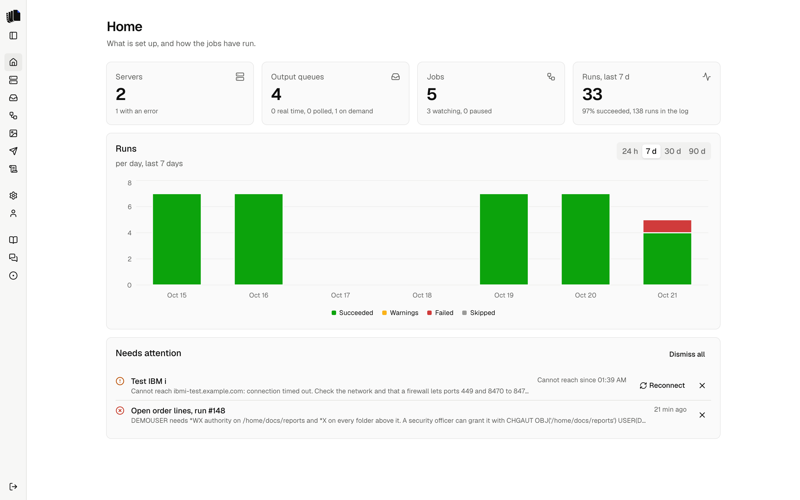

## What you need

- An IBM i 7.4 or later, a user profile that can read the output queues you
  care about, and network access from the Spooldoc host to the host server
  ports jt400 uses: 449 and 8470 to 8476. See [Network](deployment.md#network).
- Docker, or Node 22 with a JDK 17, Postgres and a Carbone server to run
  from source.
- Optional: an API key for a model provider, so the agent can write
  definitions and templates. Spooldoc works without one.

No demo queues yet? [demo-spool](../demo-spool/README.md) creates three
output queues and prints invented invoices, pick lists and reports on any
IBM i, including a free PUB400 account.

## Install

### With Docker Compose

```sh
git clone https://github.com/Strom-Capital/spooldoc.git && cd spooldoc
printf 'BETTER_AUTH_SECRET=%s\nSPOOLDOC_SECRET_KEY=%s\n' "$(openssl rand -base64 32)" "$(openssl rand -base64 32)" > .env
docker compose up -d
```

This pulls the published image (web app and Java runtime) and starts it
with a Postgres database and a [Carbone](carbone.md) server, which renders
the documents; `docker compose up --build -d` builds the web app from the
clone instead. Keep the `.env` file: `SPOOLDOC_SECRET_KEY`
encrypts the saved IBM i passwords and model keys, and with another key
they must be entered again. See [Deployment](deployment.md) for the
variables, a prebuilt database, backups and upgrades.

### From source

```sh
pnpm install
docker compose up -d db                        # Postgres on localhost:5433
cp apps/web/.env.example apps/web/.env.local   # then set DATABASE_URL, BETTER_AUTH_SECRET and SPOOLDOC_SECRET_KEY
pnpm dev
```

`pnpm dev` builds the packages in watch mode and starts the web app on
port 3000, or on the next free port when 3000 is taken. Rendering needs a
Carbone server; `docker run -d -p 4000:4000 carbone/carbone-ee:full-5.15.5-fonts`
starts one, which you then set as `http://localhost:4000` under Settings,
Rendering. See [Contributing](contributing.md) for the tools and the tests.

## First run

1. **Create the first account.** Open http://localhost:3000. The login
   page offers sign-up until the first account exists; after that sign-up
   is closed.
2. **Connect Carbone.** On Settings, under Rendering, copy Spooldoc's
   public key into `CARBONE_AUTHENTICATION_PUBLIC_KEY` in `.env`, run
   `docker compose up -d carbone` and click Check again. See
   [Carbone](carbone.md).
3. **Add a server.** On Servers, enter a name, the host, a user profile and
   its password. Optionally list the libraries to show queues from. The
   password is stored encrypted. See [Servers](servers.md).
4. **Open the queues.** On Queues, pick the server. Search or sort, hide
   the queues you do not need, and open one to see its spooled files and
   their pages. See [Queues](queues.md).
5. **Start a job.** From a queue, choose New job. The job builder shows the
   pipeline: source, trigger, extract, render, destination, finish. Next
   at the end of each step opens the one after it. Pick a spooled file on
   the queue as the preview sample.
6. **Let the agent propose.** With a model set under Settings, ask the
   agent for a definition. It reads the sample pages, writes a YAML
   definition, reads the extraction report and fixes missing fields, then
   asks whether you want an HTML or a Word template, writes it and renders
   it. The page view, the JSON and the
   preview update as it works. Without a model, write the definition by
   hand; the starter template renders every field and table. See
   [Definitions](definitions.md) and [Templates](templates.md).
7. **Pick a destination.** Spooldoc download keeps the files in Spooldoc.
   An IFS folder, added on the Destinations page, writes them to the IBM i.
   See [Destinations](destinations.md).
8. **Save a version and run it.** Runs use the active version. Run now
   takes one spooled file from the queue; Watch the queue runs every new
   one, in real time through a data queue or by polling. See [Jobs](jobs.md).
9. **Check the job log.** Every run shows its steps, errors and the
   delivered files. See [Job log](job-log.md).

Not sure what a button does? Rest the pointer on it, or move to it with
Tab. A short hint says what it does, what it changes, and why it is
disabled when it is.

<p align="center">
  <picture>
    <source media="(prefers-color-scheme: dark)" srcset="assets/home-dark.png">
    
  </picture>
</p>

## Next steps

- [Configuration](configuration.md): the default code page, allowed hosts, the server log.
- [Security](security.md): what the model receives, what the database holds.
- [FAQ](faq.md): the questions that come up first.
