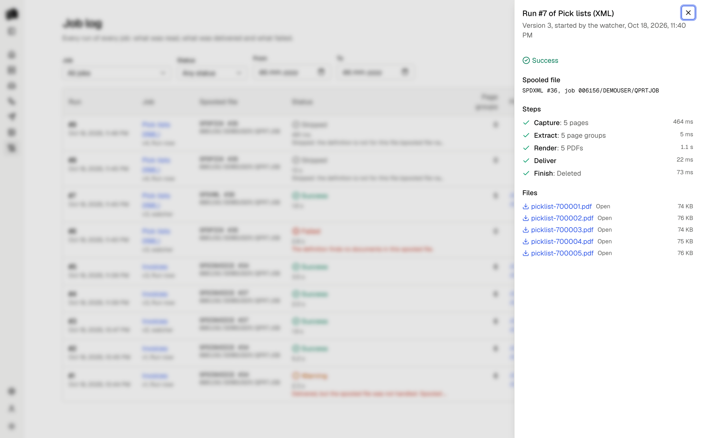
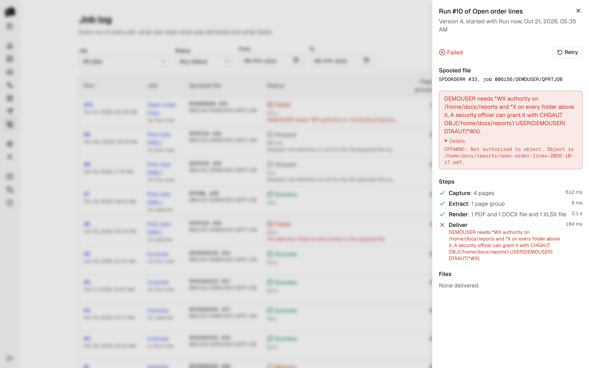
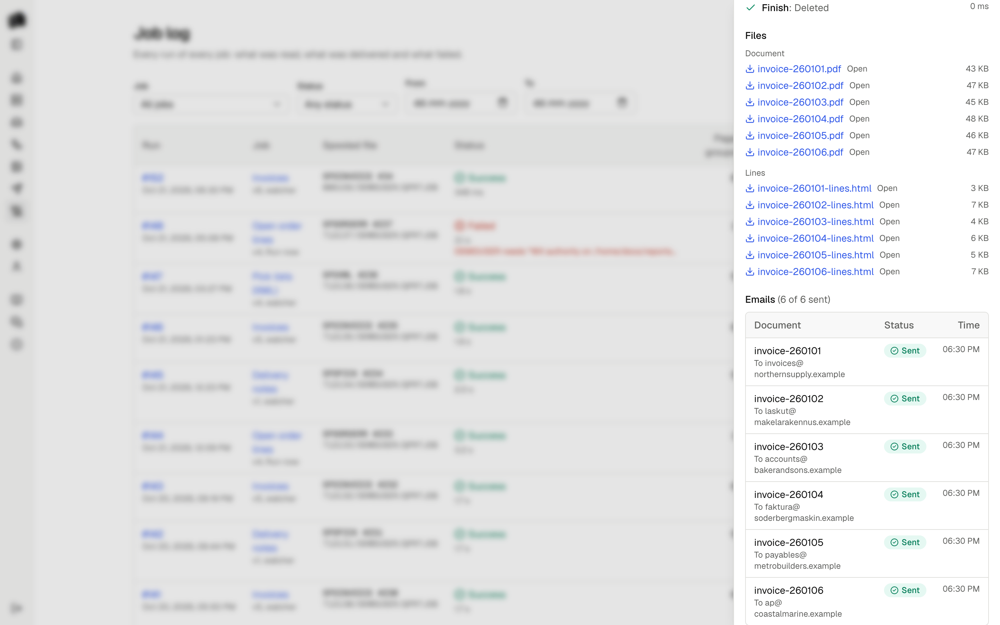
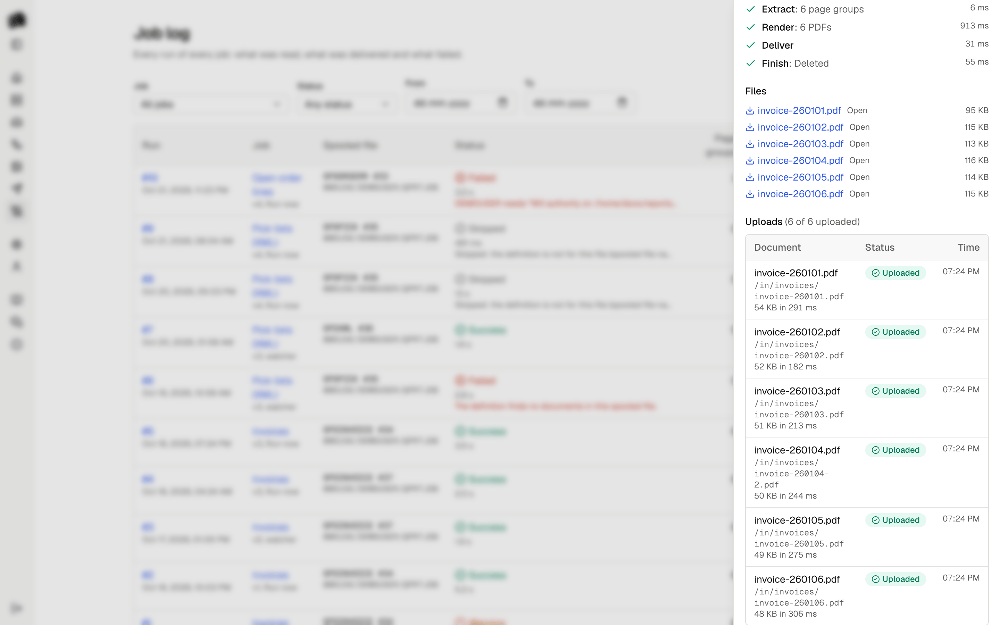

The Job log lists every run of every job, newest first: the job and the
version it used, the spooled file, what started it (Run now or the
watcher), when it started, its status, and the files it delivered.
Filter by job, status and date. Open a run to see its steps.
Filtered to one job, the path at the top names the job, and Job log in
the path opens the log without filters.

  <picture>
    <source media="(prefers-color-scheme: dark)" srcset="assets/job-log-dark.png">
    
  </picture>

## Statuses

| Status | Meaning |
|--------|---------|
| Running | The run is in progress. A run whose server stopped while it ran is marked failed within a few minutes. |
| Success | Every document was delivered and the finish step did what it should. |
| Warning | The documents were delivered, but something needs a look: the finish step failed and the spooled file is still where it was (hold, move or delete it by hand, or retry), or a [lookup](lookups.md#when-no-row-is-found) found no row and left its values empty. |
| Failed | A step failed, or a document took no [route](destinations.md#routes). What was delivered before stays delivered. The error names the step and the cause, with secrets removed. The spooled file is left alone. |
| Skipped | The spooled file does not pass the definition's `match` rules, so it is not one the job is for. It is left alone. |

Failed and warning runs appear under Needs attention on the Home page
until they are dismissed, as do servers that cannot be reached, jobs whose
watcher reports an error, and queues that are polled because real-time
watching stopped. What fails before a run exists, such as a server the
watcher cannot reach, is also in the [server log](configuration.md#server-log).
With [alerts](configuration.md#alerts) on, each of them is also sent by
email, once when it starts and once when it is fixed.

## Runs cut off by a restart

A running run touches its heartbeat every 30 seconds. When the server
stops in the middle of a run, the heartbeat stops too, and the watcher
marks the run failed once the heartbeat is 3 minutes old, with "The run
was cut off". Retry it to run the file again.

## Steps

| Step | What it does |
|------|--------------|
| Capture | Reads the spooled file and stores it as a sample. |
| Extract | Matches the file against the definition and reads its page groups. |
| Lookups | Runs the job's [lookups](lookups.md) against Db2 for i and lookup tables for every page group, such as "1 lookup, 6 queries". Each lookup table it read is named with its revision, such as "payment-terms revision 4". Shown only when the job has lookups. A lookup that finds no row and warns is listed under the step with its document, such as "No row in customer for customerNo 10042 (invoice-260101)". |
| Render | Checks each template, then makes the document of each page group with it, in the template's formats, with [Carbone](carbone.md). An Excel template of the whole spooled file makes one document of all of them. A failed render shows Carbone's own text under Details. |
| Route | Sends each document to the first [route](destinations.md#routes) it matches, such as "Route 1: 9 page groups, otherwise: 2, no route: 1". Shown only when the job has several routes or conditions. A document that takes no route is listed under the step with why each route did not take it, such as "Page group 3 (invoice-1003): pg.country is DK, not SE". A long list shows the first 50 and says how many more there are. |
| Deliver | Hands the files to the destination. With several destinations there is one Deliver step for each destination of each route, such as "Deliver to MYIFS, route 2". One that fails does not stop the next. |
| Finish | Holds, moves, deletes or leaves the spooled file, only when every route delivered every document. |

Each step is recorded with its outcome, so a run shows where it stopped.
The captured sample and the delivered files stay with the run while it is
kept. When the job has more than one template, the run's files are
grouped by template. The log's Page groups column counts what the
definition found. With several routes, each email, webhook call, file
written and upload says the route that sent it, such as "Route 2".

  <picture>
    <source media="(prefers-color-scheme: dark)" srcset="assets/job-log-failed-dark.png">
    
  </picture>

## Emails

A run of a job that delivers to an [email destination](destinations.md#email)
has an Emails section under its files, with a count such as "Emails (42
of 43 sent)". It lists one email per document: the document, the
addresses it was for, its status and the time.

  <picture>
    <source media="(prefers-color-scheme: dark)" srcset="assets/job-log-emails-dark.png">
    
  </picture>

| Status | Meaning |
|--------|---------|
| Sent | The mail server took the email. |
| Test | Sent to the destination's test address instead. |
| Sent in run #N | An earlier run of the job sent it for the same spooled file, with the same creation time, pages and name, so it was not sent again. |
| Failed | Open the row to see why, with the mail server's own text under Details. |

A long list shows the first 50 emails and says how many more there are.
A run that sent nothing says "This run sent no email."

## Webhook calls

A run of a job that delivers to a [webhook destination](destinations.md#webhook)
has a Webhook calls section under its files, with a count such as
"Webhook calls (5 of 6 sent)". It lists one call per document: the
document with the URL it was posted to, without its scheme and query string, and
the receiver's answer with the tries, such as "200 OK in 142 ms, 3
tries" or "No answer after 3 tries", then its status and the time.

  <picture>
    <source media="(prefers-color-scheme: dark)" srcset="assets/job-log-webhooks-dark.png">
    
  </picture>

| Status | Meaning |
|--------|---------|
| Sent | The receiver answered with a 2xx status. |
| Test | Sent to the destination's test URL instead. |
| Sent in run #N | An earlier run of the job sent it for the same spooled file, with the same creation time, pages and name, so it was not sent again. |
| Failed | Open the row to see why, with the receiver's answer, its first 2 KB, under Details. A document the run did not try says "Not sent" and why. |

A run that sent nothing says "This run sent no webhook call."

## Uploads

A run of a job that delivers to an [SFTP destination](destinations.md#sftp)
has an Uploads section under its files, with a count such as "Uploads (5
of 6 uploaded)". It lists one row per file: the file, the path it got on
the server, such as `/in/invoices/invoice-260101-2.pdf` when a number was
added, its size and how long the upload took, then its status and the
time.

  <picture>
    <source media="(prefers-color-scheme: dark)" srcset="assets/job-log-uploads-dark.png">
    
  </picture>

| Status | Meaning |
|--------|---------|
| Uploaded | The file is in the folder on the server. |
| Test | Uploaded to the destination's test folder instead. |
| Uploaded in run #N | An earlier run of the job uploaded it for the same spooled file, with the same creation time, pages and name, so it was not uploaded again. |
| Failed | Open the row to see why, with the server's own text under Details. A file the run did not try says "Not uploaded" and why. |

A run that uploaded nothing says "This run uploaded no file."

## Files written

A run of a job that delivers to an [IFS folder](destinations.md#ifs-folder)
has a Files written section under its files, with a count such as "Files
written (5 of 6 written)". It lists one row per file: the file, the path
it got in the IFS, such as `/home/docs/out/invoice-1001-2.pdf` when a
number was added, its size and how long the write took, then its status
and the time.

| Status | Meaning |
|--------|---------|
| Written | The file is in the folder. |
| Written in run #N | An earlier run of the job wrote it for the same spooled file, with the same creation time, pages and name, so it was not written again. |
| Failed | Open the row to see why, with the IBM i's own text under Details. A file the run did not try says "Not written" and why. |

A run that did not get to write, such as one whose template failed, has
no Files written section. Neither do runs from before Spooldoc kept this
list, though they wrote their files: the Deliver step says what they
wrote.

## Retry

Retry runs the same spooled file again with the job's active version, as
a new run. Use it after fixing a definition or a template, or after a
finish step failed. Spooldoc remembers which spooled files a job has
processed, so the watcher never runs a file a second time on its own.

Retry sends again only what was not already sent through this
destination. A job that now delivers through another destination sends
everything through the new one.

When documents took no [route](destinations.md#routes), add a route that
takes them, such as Otherwise, save a version and Retry. The documents
that were sent show as sent, and only the others go. The spooled file is
held, moved or deleted once every document was delivered.

With an email destination, Retry sends only the emails that were not sent
yet. The ones an earlier run sent show as "Sent in run #N", and the
Deliver step says so: "Sent 1 email, 42 were sent in run #12". A Retry
that starts while another run is still sending email for the same
spooled file waits for it first, so no email goes out twice. While the
destination has a test address, Retry sends every email to it, also the
ones sent for real before.

With a webhook destination, Retry sends only the documents that were not
sent yet, each with the same `webhook-id` as before: "Sent 1 document to
hooks.example.com, 5 were sent in run #12". A Retry that starts while
another run is still sending calls for the same spooled file waits for it
first. While the destination has a test URL, Retry sends every document
to it, also the ones sent for real before.

With an IFS destination, Retry writes only the files that the
destination has not written yet to its folder: "Wrote 1 file to
/home/docs/out on ibmi.example.com, 5 were written in run #12". So a
setting of Add a number never makes a second copy of a file on retry,
and with Fail the run the files the earlier run wrote are not in the
way. A Retry that starts while another run is still writing files of the
same spooled file waits for it first. A run from before Spooldoc kept
the Files written list has no record of its files, so a Retry of it
writes every file again.

With an SFTP destination, Retry uploads only the files that the
destination has not uploaded yet to its folder on its server: "Uploaded
1 file to /in/invoices on sftp.example.com, 5 were uploaded in run #12".
So a setting of Add a number never makes a second copy of a file on
retry. A Retry that starts while another run is still uploading files of
the same spooled file waits for it first. While the destination has a
test folder, Retry uploads every file to it, also the ones uploaded for
real before.

## Retention

Settings holds how long runs are kept: 90 days by default, 1 to 3650. Once
an hour the watcher deletes runs that finished longer ago, with their
captured spooled files and delivered files, preview samples no job
uses, uploaded Word and Excel templates that no draft or version uses,
the agent's [usage](agent.md#usage) records from before then, and
[alerts](configuration.md#alerts) that were fixed before then. The record of which spooled files were processed is kept, so a file
is not run again after its run is gone. Runs are deleted in small batches
so no single delete holds its locks for long.
