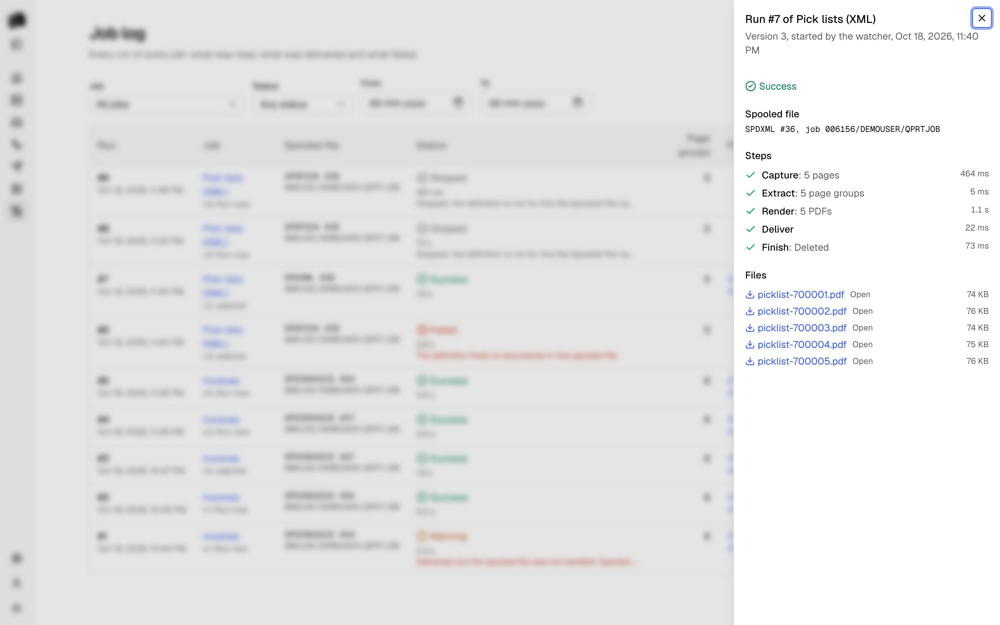
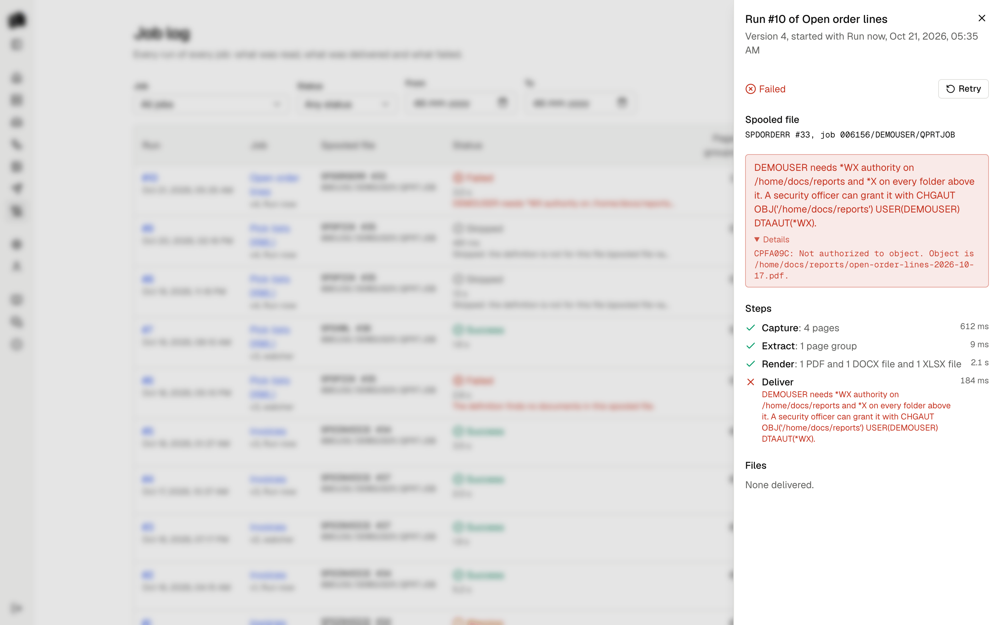

The Job log lists every run of every job, newest first: the job and the
version it used, the spooled file, what started it (Run now or the
watcher), when it started, its status, and the files it delivered.
Filter by job, status and date. Open a run to see its steps.
Filtered to one job, the path at the top names the job, and Job log in
the path opens the log without filters.

  <picture>
    <source media="(prefers-color-scheme: dark)" srcset="assets/job-log-dark.png">
    
  </picture>

## Statuses

| Status | Meaning |
|--------|---------|
| Running | The run is in progress. A run whose server stopped while it ran is marked failed within a few minutes. |
| Success | Every document was delivered and the finish step did what it should. |
| Warning | The documents were delivered, but the finish step failed: the spooled file is still where it was. Hold, move or delete it by hand, or retry. |
| Failed | A step failed before anything was delivered. The error names the step and the cause, with secrets removed. The spooled file is left alone. |
| Skipped | The spooled file does not pass the definition's `match` rules, so it is not one the job is for. It is left alone. |

Failed and warning runs appear under Needs attention on the Home page
until they are dismissed, as do servers that cannot be reached, jobs whose
watcher reports an error, and queues that are polled because real-time
watching stopped. What fails before a run exists, such as a server the
watcher cannot reach, is also in the [server log](configuration.md#server-log).

## Runs cut off by a restart

A running run touches its heartbeat every 30 seconds. When the server
stops in the middle of a run, the heartbeat stops too, and the watcher
marks the run failed once the heartbeat is 3 minutes old, with "The run
was cut off". Retry it to run the file again.

## Steps

| Step | What it does |
|------|--------------|
| Capture | Reads the spooled file and stores it as a sample. |
| Extract | Matches the file against the definition and reads its page groups. |
| Render | Checks each template, then makes the document of each page group with it, in the template's formats, with [Carbone](carbone.md). An Excel template of the whole spooled file makes one document of all of them. A failed render shows Carbone's own text under Details. |
| Deliver | Hands every file to the destination. |
| Finish | Holds, moves, deletes or leaves the spooled file. |

Each step is recorded with its outcome, so a run shows where it stopped.
The captured sample and the delivered files stay with the run while it is
kept. When the job has more than one template, the run's files are
grouped by template. The log's Page groups column counts what the
definition found.

  <picture>
    <source media="(prefers-color-scheme: dark)" srcset="assets/job-log-failed-dark.png">
    
  </picture>

## Retry

Retry runs the same spooled file again with the job's active version, as
a new run. Use it after fixing a definition or a template, or after a
finish step failed. Spooldoc remembers which spooled files a job has
processed, so the watcher never runs a file a second time on its own.

## Retention

Settings holds how long runs are kept: 90 days by default, 1 to 3650. Once
an hour the watcher deletes runs that finished longer ago, with their
captured spooled files and delivered files, preview samples no job
uses, uploaded Word and Excel templates that no draft or version uses,
and the agent's [usage](agent.md#usage) records from before then. The record of which spooled files were processed is kept, so a file
is not run again after its run is gone. Runs are deleted in small batches
so no single delete holds its locks for long.
