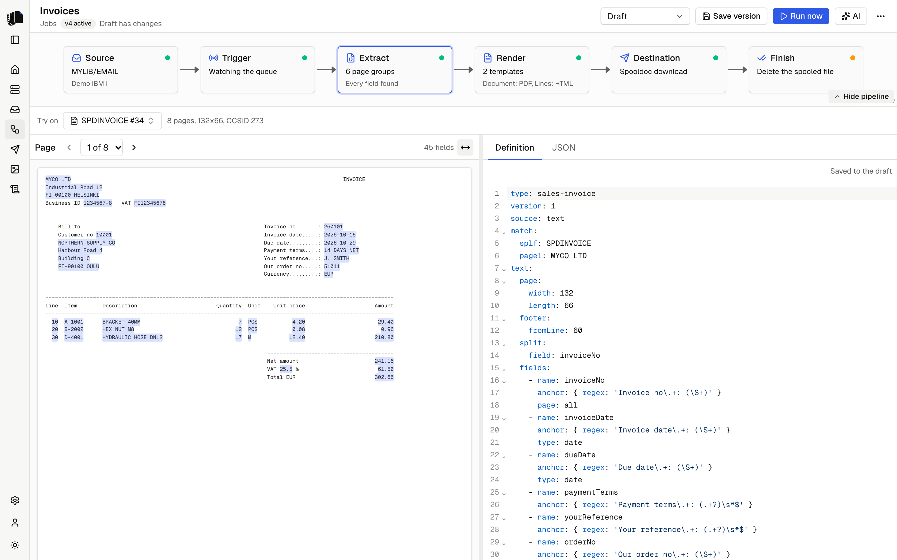

A job is a pipeline from one output queue to a destination. The Jobs page
lists them with their server, queue, trigger and last run. A job whose
active version or draft no longer matches the job format, after an upgrade
for example, is listed with the reason instead of breaking the page. The
job builder shows the pipeline as six steps, and each step opens an
inspector. Hide pipeline under the steps makes more room, and Show
pipeline brings them back.

  <picture>
    <source media="(prefers-color-scheme: dark)" srcset="assets/job-builder-dark.png">
    
  </picture>

| Step | What you set |
|------|--------------|
| Source | The server, the output queue, and filters on spooled file name, user data, job name, job user and form type. Each filter is a "contains" match; empty means any file on the queue. |
| Trigger | On demand, or Watching the queue, and whether held files count. See [Running on demand](#running-on-demand) and [Watching a queue](#watching-a-queue). |
| Extract | The [definition](definitions.md): the YAML that turns pages into JSON. |
| Render | The [templates](templates.md): each has a name, HTML or a Word file, and the formats it makes. The starter template renders every field and table of the definition until you write your own. See [Templates](#templates). |
| Destination | Where the files go. See [Destinations](destinations.md). |
| Finish | What happens to the spooled file after every document was delivered. |

## Designing with a sample

The extract and render steps open the workbench: the sample's pages with
the field hits highlighted, the definition, the extracted JSON, the
template and the rendered document of one page group: the HTML of an
HTML template, or the PDF of a Word template. Pick a spooled file on
the queue as the preview sample; Spooldoc saves a copy in the database,
and the workbench shows that copy, marked "saved copy", also after the
file leaves the queue. Pick another file to save a new copy. Only drafts have a preview sample, and samples no job uses are deleted
with the old runs.

The bar above the workbench shows what you are looking at as a path:
the spooled file, then its page group, such as "Page group 2 of 6", then
on the extract step the page, such as "Page 3 of 8". Each has previous
and next buttons and a list to jump to any one. The page and the page
group follow each other: picking a page group shows its first page, and
paging into another page group picks it. Fit width and 100% in the
corner of the page fit it to the pane or show its actual size. Hover the
spooled file for when the copy was saved, its page count, page size and
CCSID.

The [AI assistant](ai-assistant.md) sits beside the workbench. It writes
the definition and the template to the draft, reads the extraction report
and renders the result, and the page view, JSON and preview update as it
works. Everything it writes can be edited by hand.

## Templates

The definition splits a spooled file into page groups, such as one
invoice each, and every page group becomes a document through every
template of the job. A new job has one template, Template 1, that makes
a PDF. Add another when the same data needs a second document, for
example an invoice as a PDF and its lines as a separate HTML page.

On the render step the path ends at the template that the editor and
the preview show, such as "Document". The menu next to it has the files
the template makes, Make it a Word template (or an HTML template),
Rename, Remove and Add template. An HTML template makes PDF and HTML
files; a [Word template](templates.md#word-templates) makes PDF and DOCX
files. Switching the kind starts the template from the other kind's
starter, and asks first when it has HTML or a Word file of its own;
saved versions keep theirs. The last template cannot be removed. The
pipeline shows one template as its kind and formats, and several as
"2 templates" with each name and its formats.

The first template's files are named after the document, as in
`invoice-260101.pdf`. Every other template adds its name, so a Lines
template gives `invoice-260101-lines.html`. Two templates cannot have the
same name.

## Versions

The job you edit is the draft. Saving a version takes a fixed copy of the
draft, numbered from 1, with a note of what changed. Runs use the active
version, which is the newest unless you activate an older one, and every
run is logged against the version it used. Restoring a version copies it
back into the draft. A draft that differs from the active version is
marked, so you know what runs and what you are still working on.

A version must be complete: a server and queue, a definition, templates
with different names, and a destination, plus the queue to move files to
when the finish action is Move.

## Running on demand

Run now takes the spooled files you pick from the queue through the
active version and shows the runs in the [job log](job-log.md). A file the
definition's `match` rules do not accept ends as skipped and is left
alone. Retry in the job log runs the same file again with the active
version.

Run now lists the ready files the job has not processed. With held files
included in the trigger step, it lists held ones too, for programs that
print with `HOLD(*YES)`. A switch in Run now shows the rest of the queue.

## Other jobs on the same queue

When other jobs read the same output queue, the trigger step names each
one, says whether it is watching or runs on demand, and what its finish
step does. A file that matches the filters of more than one job can be
run by each, and each finish action applies to it. A watching job runs a
file as soon as it is ready, so an on-demand job on the same queue may
find it already held, moved or deleted. Use the filters on the Source step
to keep the jobs apart. Jobs with no active version and paused watchers
are not named.

## Watching a queue

With the trigger set to Watching, the queue watcher runs the job for every
new ready spooled file, in one of two ways:

- **Real time.** The output queue sends an entry to a data queue when a
  spooled file becomes ready, and Spooldoc reads that data queue. Set up
  real-time in the trigger step creates a data queue in the queue's library
  and attaches it with `CHGOUTQ DTAQ(...)`. When the queue already sends to
  a data queue, another program probably reads it, so Spooldoc leaves the
  queue alone and polls; you can let Spooldoc read that data queue instead,
  as long as the server has no other one. Switch to polling detaches a data
  queue Spooldoc created, or stops reading one that was there before.
- **Polling.** Any other queue is listed every poll interval, 30 seconds by
  default. Real-time queues are polled too, every safety check interval,
  in case an entry was missed. Both intervals are under Settings.

When reading the data queue fails, for example because the data queue was
deleted or the connection dropped, the queue is polled at the poll
interval meanwhile and Spooldoc keeps trying to read it again. The trigger
step and Needs attention on the Home page say why and since when, and the
[server log](configuration.md#server-log) has each attempt. Once reading
works again, the note goes away. After a dropped connection, Spooldoc opens
a new one by itself, so real-time watching comes back without a restart;
see [Connection status](servers.md#connection-status).

Every run renders with [Carbone](carbone.md). While Carbone does not work,
the watcher starts no runs: new spooled files wait on the queue, and the
trigger step, the Jobs list and Needs attention say "New spooled files
wait until Carbone works again", with the reason. Before each file the
watcher looks at the last check of Carbone, and checks again when the last
check failed more than a minute ago. Once Carbone works, every waiting file
runs, oldest first, and the note goes away. A render that finds Carbone
down fails that one run, which you can retry from the
[Job log](job-log.md#retry); the files after it wait.

Two more switches:

- **Backlog.** When watching starts, Spooldoc takes stock of the queue.
  Leave them for Run now ignores the files already there; Run them too
  runs them.
- **Held files.** By default the watcher takes ready files. With held files
  included it takes held ones too, which is how a queue with no writer is
  usually set up.

Pause a job to stop watching without losing anything; the files that
arrive meanwhile are left for Run now, or run when watching resumes with
Backlog on. Each file runs once: Spooldoc remembers which spooled files a
job has processed, even after the runs are deleted.

## The finish step

After every document of a spooled file was delivered, the finish step does
one of:

| Action | What happens |
|--------|--------------|
| Hold (default) | `HLDSPLF`, so the file stays on the queue and is not printed. |
| Move | The file is moved to another output queue, for example an archive queue. |
| Delete | The file is deleted from the IBM i. This cannot be undone. |
| Leave as is | Nothing. With a watcher, Spooldoc still runs the file only once. |

Delete is the one action that destroys something on the IBM i, so
Spooldoc asks before it starts. Saving a version as the active one, or
making a saved version active, when that version deletes and the active
version does not, shows which queue's files will be deleted and needs a
second click. The API answers `409` with `confirm: "delete"` until the
request carries `confirmDelete: true`. Once a deleting version is active,
later deleting versions need no confirmation. The Jobs list marks a job
whose active version deletes its spooled files.

A finish that fails leaves the run with the status warning: the documents
are delivered and the spooled file is where it was. Previews only read.
