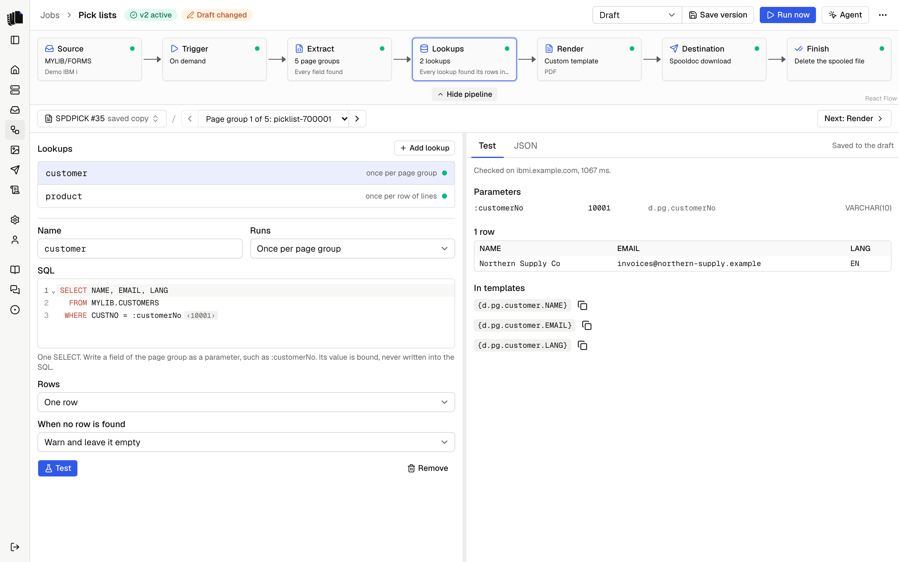
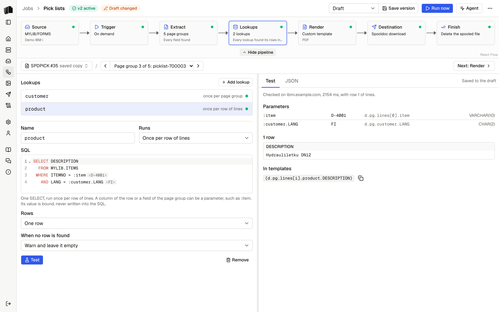
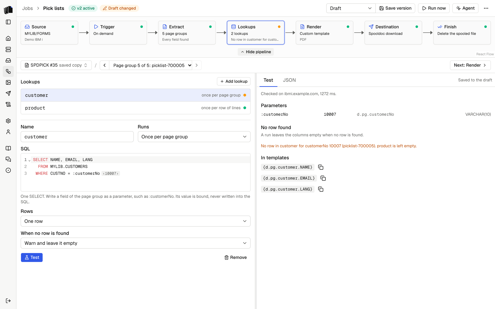
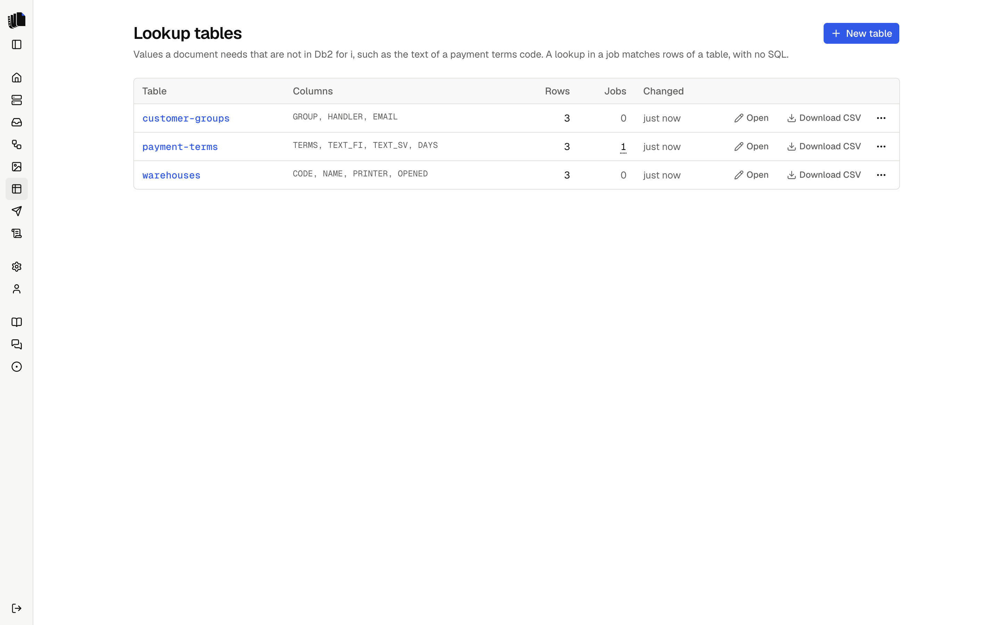
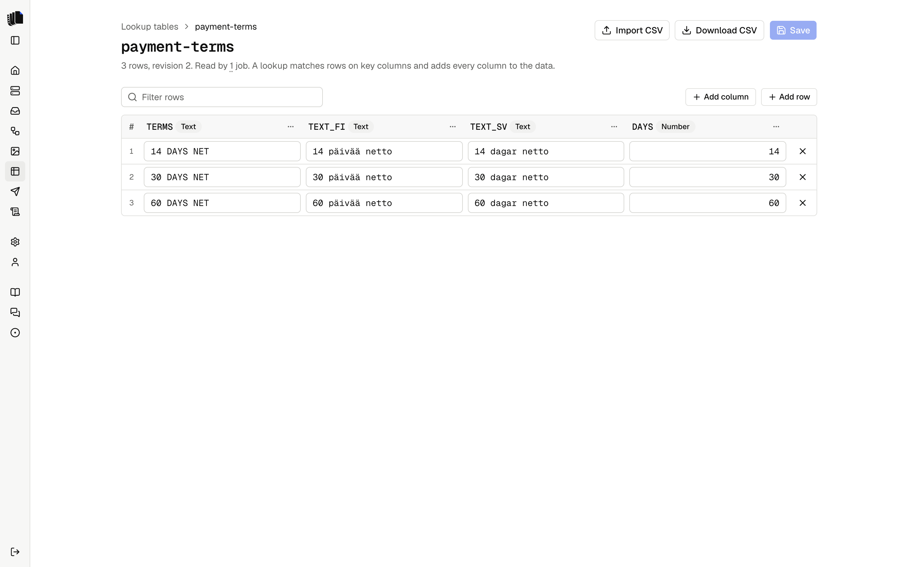
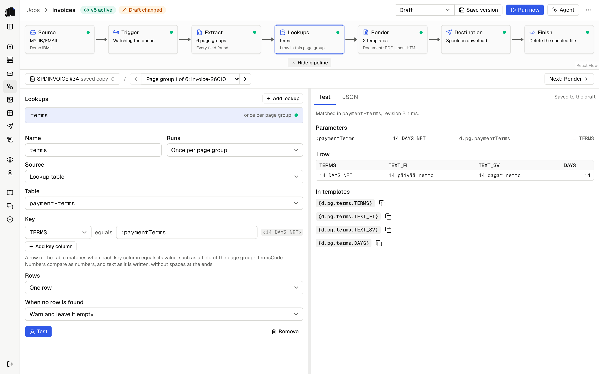

Many printed documents leave out something the document needs, most often
the customer's email address. A lookup reads it from Db2 for i instead, so
the program and its spooled file stay as they are. Values that have no
home in Db2 for i, such as the text of a payment terms code, go in a
[lookup table](#lookup-tables) kept in Spooldoc.

A lookup runs after the definition has read each page group and before
the templates render it. It takes values the definition read, such as the
customer number, and adds the rows it finds to the page group's data.
Templates, file names and email fields then use them like any other
field: `{d.pg.customer.EMAIL}`.

A lookup reads from one of two sources:

- **Db2 for i**: one SELECT statement, run on the job's server.
- **Lookup table**: the rows of a table kept in Spooldoc whose key columns
  equal values of the page group. No SQL, and no server.

Lookups only read. A Db2 for i lookup runs on a read-only connection, and
nothing on the IBM i changes. See [On the IBM i](security.md#on-the-ibm-i).

## Writing a lookup

Open the Lookups step of the job builder, between Extract and Render, and
pick **Add lookup**. A lookup has:

| Field | What it holds |
|-------|---------------|
| Name | The key of its values in the data, such as `customer`. Letters, digits and underscores, starting with a letter. It cannot be the name of a field or table of the definition. |
| Runs | Once per page group, or once per row of a table of the definition. See [Row lookups](#row-lookups). |
| Source | Db2 for i, or Lookup table. See [Lookup tables](#lookup-tables). |
| SQL | For Db2 for i: one SELECT, with parameters such as `:customerNo`. |
| Table and Key | For a lookup table: the table, and the key columns that must equal values of the page group. |
| Rows | One row, as an object, or all rows, as a list. See [One row or all rows](#one-row-or-all-rows). |
| When no row is found | Stop the run, warn and leave it empty, or leave it empty. See [When no row is found](#when-no-row-is-found). |

To send each invoice to the email address in the customer master, with
the customer number the definition reads as `customerNo`:

```sql
SELECT NAME, EMAIL, LANG
  FROM MYLIB.CUSTOMERS
 WHERE CUSTNO = :customerNo
```

Name it `customer`, and the data of each page group gets:

```json
"customer": { "NAME": "Example Oy", "EMAIL": "ap@example.com", "LANG": "FI" }
```

Write the email destination's To as `{d.pg.customer.EMAIL}`. **Insert
field** in the Destination step lists the lookup's columns. A template
writes the same tag, such as `<p>{d.pg.customer.NAME}</p>`.

<p align="center">
  <picture>
    <source media="(prefers-color-scheme: dark)" srcset="assets/lookups-step-dark.png">
    
  </picture>
</p>

The columns keep the names Db2 for i gives them: `EMAIL`. Give a column
another name with `AS`, and a lowercase one in quotes:
`EMAIL AS "email"`. A column made from an expression needs a name too,
such as `TRIM(NAME) AS NAME`.

Values are typed by their Db2 for i type, as the definition types fields,
so templates format them the same way. DECIMAL, NUMERIC, INTEGER and the
other number types are numbers. DATE is a date. CHAR, VARCHAR, TIMESTAMP
and the rest are text, without trailing blanks.

Lookups run in their order in the list, so a later lookup can use the
columns of an earlier one.

## Parameters

A parameter is a colon and a name: `:customerNo`. It names one value:

- a field of the page group, such as `:customerNo`;
- a column of an earlier lookup that reads one row, such as
  `:customer.LANG`;
- in a row lookup, a column of the row, such as `:item`.

Spooldoc binds each value to the statement. A value is never written
into the SQL. A colon inside a string constant, such as `'10:15'`, or in
a comment is not a parameter.

The SQL editor shows the value of each parameter in the page group shown,
such as `‹10042›` after `:customerNo`. A name that is not in the data is
underlined, and its hint lists the names that are.

## Row lookups

Set Runs to once per row of a table, and the lookup runs for each row of
that table and adds its values to the row. To print the description of
each item from the item master:

```sql
SELECT DESC FROM MYLIB.PRODUCTS WHERE ITEM = :item
```

Name it `product`, run it once per row of `lines`, and a template writes
`{d.pg.lines[i].product.DESC}` in the loop row.

A row lookup runs once for each distinct set of values in a run, not once
per row: an item that is on 40 invoices of a spooled file is read once.

A parameter of a row lookup can also name a field of the page group. When
a column of the row and a field of the page group have the same name,
rename one of them in the definition.

A row lookup can read an earlier lookup too. With `:customer.LANG`, each
item gets its description in the customer's language:

<p align="center">
  <picture>
    <source media="(prefers-color-scheme: dark)" srcset="assets/lookups-row-dark.png">
    
  </picture>
</p>

## One row or all rows

**One row** adds the row as an object: `{d.pg.customer.EMAIL}`. When the
query finds more than one row, the run stops: "customer returned more
than one row for customerNo 10042. Add a condition, or FETCH FIRST 1 ROW
ONLY."

**All rows** adds a list, which a template loops over:
`{d.pg.contacts[i].EMAIL}`. A lookup reads at most 1,000 rows. When the
query finds more, the run stops and says so; the rows are never cut off.

## When no row is found

| Choice | What a run does |
|--------|-----------------|
| Stop the run | The run fails at the Lookups step, with the lookup, the values and the document: "No row in customer for customerNo 10042 (invoice-260101)". Nothing is delivered and the spooled file is left alone. |
| Warn and leave it empty | The columns are empty (all rows gives an empty list), the documents are delivered, and the run ends with a warning that lists each miss in the Lookups step of the [job log](job-log.md#steps). |
| Leave it empty | The same, without a warning. |

A new lookup warns. An email destination fails each email whose To is
empty, so a customer without an address shows in the job log either way.

A later lookup that reads a column of one that found no row does not run
in that page group, or that row: with `:customer.LANG`, a `product`
lookup has no language to look up with. Its columns are left empty, and
it adds no warning of its own. The earlier lookup's warning says what it
left empty: "No row in customer for customerNo 10007 (picklist-700005).
product is left empty." When the earlier lookup stops the run, the later
one never runs.

<p align="center">
  <picture>
    <source media="(prefers-color-scheme: dark)" srcset="assets/lookups-miss-dark.png">
    
  </picture>
</p>

A parameter whose field is empty on the page is different: it is bound
as NULL and the lookup runs. A condition such as `CUSTNO = :customerNo`
finds no row for NULL, so the lookup does what When no row is found says,
and its warning shows the value as "(empty)".

## Test

**Test** checks the lookup on the job's server and runs it with the
values of the page group shown:

1. the names and parameters, without the IBM i;
2. the statement: one SELECT that Db2 for i accepts, its columns and the
   type of each parameter;
3. the lookup itself, with the values of the page group (for a row
   lookup, the first row of its table).

The Test tab shows the server and the time it took, each parameter with
its value, where it came from and its Db2 for i type, the rows, and the
tags templates write for each column, with a copy button. A Test belongs
to the page group it ran with: on another page group, or another preview
file, the tab shows what the preview found there instead, with its
parameters and rows, or the earlier lookup that left it empty. The tags
show only while the SQL is the one last tested. The JSON tab
shows the page group as templates get it, with the values of the lookups.

A version can only be saved with lookups that were tested since they last
changed: "Test lookup customer before you save this version." Saving
needs no connection to the IBM i; each lookup keeps the columns its last
Test found. The template check and the email fields know those columns,
so `{d.pg.customer.EMAIL}` is checked like any field.

The preview runs the lookups that are tested, in their order, up to the
first one that is not. It keeps each result for 2 minutes, so a change to
a template does not query the IBM i again. When a lookup cannot run in
the preview, the document renders without its values, and the Lookups
step shows why.

The pipeline shows the Lookups step as ready with no lookups, and with
lookups that are tested and ran. A lookup that is not tested, has a
problem or failed in the preview shows as a problem. One that found no
row in the page group shown is worth a look.

## Lookup tables

Some values a document needs are not in Db2 for i, and nobody wants a
table there for them: a short code mapped to the text the document
prints, the email address of whoever handles a customer group, or the
logo for each company code. Keep them in a lookup table instead. People
who never edit templates can change the values.

### The Lookup tables page

**Lookup tables** in the sidebar lists the tables, with their columns,
how many rows each has, the jobs that read it and when it changed.
**New table** asks for a name, such as `payment-terms`: lowercase letters,
digits, dashes and underscores, starting with a letter or digit. A new
table starts empty, with the columns `CODE` and `TEXT`, or from a CSV file
or cells pasted from a spreadsheet.

<p align="center">
  <picture>
    <source media="(prefers-color-scheme: dark)" srcset="assets/lookup-tables-dark.png">
    
  </picture>
</p>

Open a table to edit it in a grid, 100 rows a page, with a filter box
that finds rows by any cell.

- Up and Down, and Enter, move to the cell above or below. Cells
  copied from a spreadsheet and pasted into a cell fill the block from
  that cell, adding rows as needed.
- **Add row** and the button at the end of a row add and delete rows.
- **Add column** adds one. The menu of a column renames it, changes its
  type, moves it left or right, or deletes it.
- **Import CSV** replaces the columns and rows with those of a CSV file or
  pasted cells. It shows what it read first: the delimiter, each column
  with its type, and the first rows. A column the table already has keeps
  its type.
- **Download CSV** saves the table as last saved.
- **Save** saves the table: "Saved payment-terms".

Changes are saved together, with Save. Leaving the page with changes
that are not saved asks first. When someone else saved the table since
you opened it, Save says so: "Could not save: payment-terms changed since
you opened it. Reload to see the changes." **Download your changes** then
saves the grid as it is on your screen as a CSV file, so you can reload
and import it without losing your edits. Each save raises the table's
revision by one.

<p align="center">
  <picture>
    <source media="(prefers-color-scheme: dark)" srcset="assets/lookup-table-dark.png">
    
  </picture>
</p>

### Columns and types

A column name is what templates write, so it follows the rule for lookup
names: letters, digits and underscores, starting with a letter, such as
`TEXT`. Templates write `{d.pg.terms.TEXT}`.

Each column is one of three types:

| Type | Cells |
|------|-------|
| Text | Anything, as typed. |
| Number | A number, with a decimal point or a decimal comma: `1.5` or `1,5`. |
| Date | A date as `YYYY-MM-DD`, or typed as `DD.MM.YYYY`. |

Values reach the template typed, as the definition types fields, so
templates format them the same way. An empty cell is empty in the data.

A cell that does not fit its column's type is marked, and Save stays
off until it is fixed. The message says how many cells and where the
first one is: "2 cells do not fit their column. The first is row 12,
column RATE, which takes a number."

### CSV files

Import and **New table** read a CSV whose first row names the columns.

- The delimiter is a comma, a semicolon or a tab, found from the first
  row. Cells copied from a spreadsheet are tab delimited.
- With semicolons or tabs, numbers are read with a decimal comma, as a
  spreadsheet saves and copies them in Finnish or German: `1,5`. With
  commas, numbers take a decimal point.
- A file is read as UTF-8. A file that is not UTF-8, as older spreadsheets
  save CSV, is read as Windows-1252, and the preview says so.
- Rows with every cell empty, such as the `;;;` lines a spreadsheet saves,
  are left out.
- A cell in double quotes can hold the delimiter, a line break or a
  doubled quote. A byte order mark at the start is skipped.
- A new column's type comes from its cells: Number when every cell is a
  number, Date when every cell is a date, else Text. A code with a leading
  zero, such as `007`, stays text, and so does a number with more than 15
  digits, such as a long account number, which a number cannot keep
  exactly. A column the table already has keeps its type, and a cell that
  does not fit it is marked.
- A header that is not a column name is refused, and the message names
  it: "Column 2 of the CSV is named "Due date", which templates cannot
  read."

**Download CSV** writes UTF-8 with a byte order mark, so a spreadsheet
shows ä and ö, comma delimited, with a decimal point and dates as
`YYYY-MM-DD`.

A table holds up to 10,000 rows and 50 columns, and a cell up to 1,000
characters.

### A lookup that reads a table

In the Lookups step, set **Source** to Lookup table. Then pick:

- **Table**: the lookup table. With no tables yet, the step links to the
  Lookup tables page.
- **Key**: up to 5 key columns, each with the value it must equal, such as
  `TERMS` equals `:paymentTerms`. A value is written like an SQL parameter
  and names the same things: a field of the page group, a column of the
  row in a row lookup, or a column of an earlier lookup that reads one
  row.

Runs, Rows and When no row is found work as for Db2 for i. To print the
text of the payment terms the invoice prints as `paymentTerms`, name the
lookup `terms`, pick `payment-terms`, and match `TERMS` on `:paymentTerms`.
A Finnish template writes `{d.pg.terms.TEXT_FI}`.

<p align="center">
  <picture>
    <source media="(prefers-color-scheme: dark)" srcset="assets/lookups-table-dark.png">
    
  </picture>
</p>

A row matches when each key column equals its value:

- A Number column compares as numbers: `30` equals `30.00`.
- A Text column compares the text without spaces at either end, and
  upper and lower case differ, as Db2 for i compares CHAR.
- A Date column compares dates as `YYYY-MM-DD`.
- An empty value matches no row, as NULL does in Db2 for i, so When no
  row is found applies.

With Rows set to One row, a key that matches two or more rows stops the
run: "terms matched 2 rows of payment-terms for CODE 30. Pick key columns
that name one row, or set Rows to All rows." All rows reads at most 1,000
rows, as a Db2 for i lookup does.

**Test** needs no server and no IBM i, unless an earlier lookup reads Db2
for i. It shows the table and its revision, each value with the key
column it must equal, the rows matched, and the tags templates write.
Changing the table or the key needs a new Test before a version is saved.

### Which table a run read

A run reads each table as it is when the run gets to the Lookups step.
The step in the [job log](job-log.md#steps) names each table it read and
its revision, such as "1 lookup, payment-terms revision 4". Spooldoc keeps
only the latest table, not earlier revisions, so the revision tells you
whether the table changed since that run, not what it held then.

### Changing or deleting a table that jobs read

A change that can break jobs asks first, and names the jobs whose lookups
read the table:

- deleting the table;
- renaming, retyping or deleting a column, since a template may print
  it, a lookup may key on it, or a later lookup may read it, such as
  `:terms.TEXT`;
- importing a CSV that drops a column or gives it another type.

After the columns change, each lookup that reads the table needs another
Test: "The columns of payment-terms changed since terms was tested. Test
it again." Until then, the preview leaves it out and its job cannot save
a version.

Renaming a table is safe: its lookups keep reading it under its new
name. Rename it from the menu of its row on the Lookup tables page.

A run whose lookup table was deleted stops at the Lookups step: "terms
reads the lookup table payment-terms, which was deleted. Pick another
table in the Lookups step." A draft with such a lookup cannot be saved as
a version until another table is picked.

## Authority

A Db2 for i lookup runs with the user profile of the job's server. It needs
`*USE` on each table or view the query reads, and `*EXECUTE` on its
library. A security officer grants them, for example:

```text
GRTOBJAUT OBJ(MYLIB/CUSTOMERS) OBJTYPE(*FILE) USER(MYUSER) AUT(*USE)
GRTOBJAUT OBJ(MYLIB) OBJTYPE(*LIB) USER(MYUSER) AUT(*EXECUTE)
```

Write tables with their library, such as `MYLIB.CUSTOMERS`. A table
without one is looked for in the library named after the user profile.

## Errors

A lookup that fails says which lookup it was and what to do. The Db2 for
i message is under Details.

| Error | What to do |
|-------|------------|
| Table or view not found (SQL0204) | Check the table and its library in the query, or the user profile's authority to the library. |
| Not authorized (SQL0551) | Grant the user profile `*USE` on the table, as in [Authority](#authority). |
| Not valid SQL (SQL0104) | Check the statement near the word Db2 for i names. |
| Column not found (SQL0206) | Check the column name, and qualify it with its table when the query joins tables. |
| A value does not fit its parameter (SQL0420) | A field gives text where Db2 for i expects a number, for example. Give the field `type: number` in the definition, or CAST the parameter. Test flags this before it runs the query when it can. |
| Timeout (SQL0952) | Each query may run 30 seconds. Make it faster, for example with an index over the columns in its WHERE clause. |
| The query would change data | A lookup runs one SELECT. The read-only connection refuses anything else. |
| More than one row, or more than 1,000 | Add a condition to the query. |
| A lookup table matched more than one row | Pick key columns that name one row, or set Rows to All rows. |
| A lookup table has no such column | A key column was renamed or deleted in the table. Pick another key column in the Lookups step. |
| The columns of a lookup table changed since the Test | Test the lookup again, and check the tags of its columns in the templates. |
| The lookup table was deleted | Pick another table in the Lookups step. |

A failed lookup stops the run at the Lookups step. Retry it from the job
log once it is fixed.
