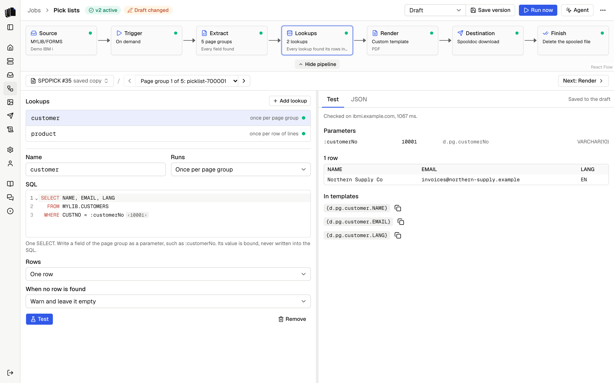
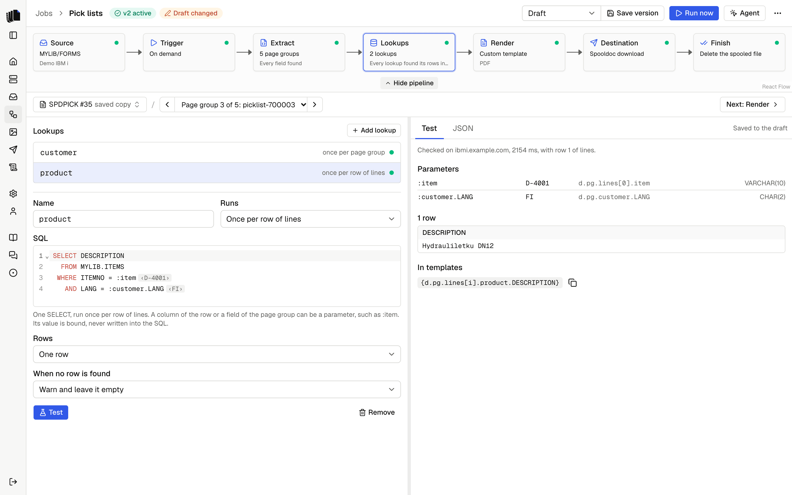
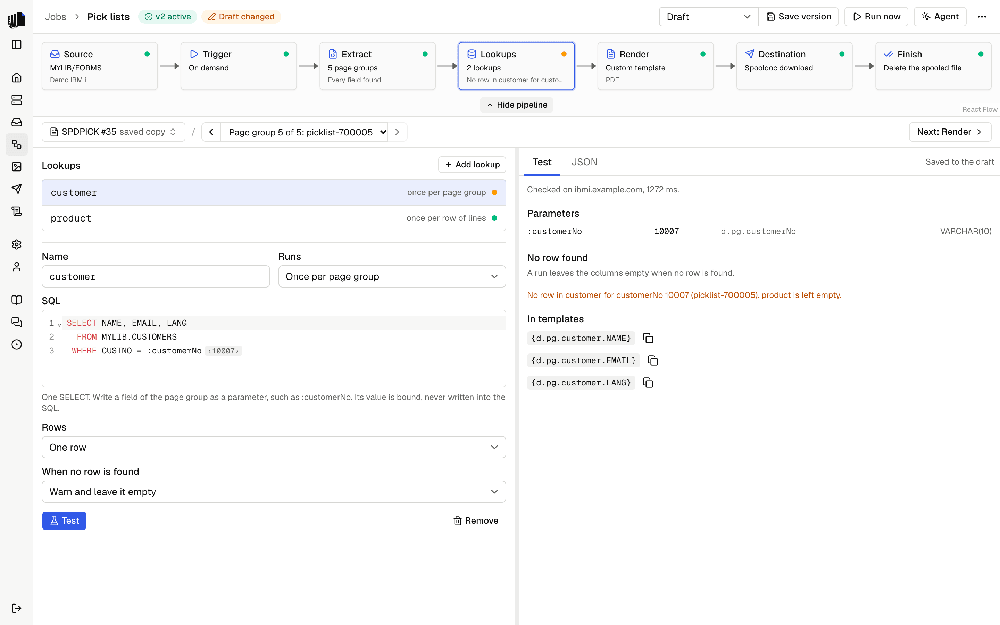

Many printed documents leave out something the document needs, most
often the customer's email address. A lookup reads it from Db2 for i
instead, so the program and its spooled file stay as they are.

A lookup is one SELECT statement. It runs after the definition has read
each page group and before the templates render it. It takes values the
definition read, such as the customer number, and adds the rows it finds
to the page group's data. Templates, file names and email fields then use
them like any other field: `{d.pg.customer.EMAIL}`.

Lookups only read. They run on a read-only connection, and nothing on the
IBM i changes. See [On the IBM i](security.md#on-the-ibm-i).

## Writing a lookup

Open the Lookups step of the job builder, between Extract and Render, and
pick **Add lookup**. A lookup has:

| Field | What it holds |
|-------|---------------|
| Name | The key of its values in the data, such as `customer`. Letters, digits and underscores, starting with a letter. It cannot be the name of a field or table of the definition. |
| Runs | Once per page group, or once per row of a table of the definition. See [Row lookups](#row-lookups). |
| SQL | One SELECT, with parameters such as `:customerNo`. |
| Rows | One row, as an object, or all rows, as a list. See [One row or all rows](#one-row-or-all-rows). |
| When no row is found | Stop the run, warn and leave it empty, or leave it empty. See [When no row is found](#when-no-row-is-found). |

To send each invoice to the email address in the customer master, with
the customer number the definition reads as `customerNo`:

```sql
SELECT NAME, EMAIL, LANG
  FROM MYLIB.CUSTOMERS
 WHERE CUSTNO = :customerNo
```

Name it `customer`, and the data of each page group gets:

```json
"customer": { "NAME": "Example Oy", "EMAIL": "ap@example.com", "LANG": "FI" }
```

Write the email destination's To as `{d.pg.customer.EMAIL}`. **Insert
field** in the Destination step lists the lookup's columns. A template
writes the same tag, such as `<p>{d.pg.customer.NAME}</p>`.

<p align="center">
  <picture>
    <source media="(prefers-color-scheme: dark)" srcset="assets/lookups-step-dark.png">
    
  </picture>
</p>

The columns keep the names Db2 for i gives them: `EMAIL`. Give a column
another name with `AS`, and a lowercase one in quotes:
`EMAIL AS "email"`. A column made from an expression needs a name too,
such as `TRIM(NAME) AS NAME`.

Values are typed by their Db2 for i type, as the definition types fields,
so templates format them the same way. DECIMAL, NUMERIC, INTEGER and the
other number types are numbers. DATE is a date. CHAR, VARCHAR, TIMESTAMP
and the rest are text, without trailing blanks.

Lookups run in their order in the list, so a later lookup can use the
columns of an earlier one.

## Parameters

A parameter is a colon and a name: `:customerNo`. It names one value:

- a field of the page group, such as `:customerNo`;
- a column of an earlier lookup that reads one row, such as
  `:customer.LANG`;
- in a row lookup, a column of the row, such as `:item`.

Spooldoc binds each value to the statement. A value is never written
into the SQL. A colon inside a string constant, such as `'10:15'`, or in
a comment is not a parameter.

The SQL editor shows the value of each parameter in the page group shown,
such as `‹10042›` after `:customerNo`. A name that is not in the data is
underlined, and its hint lists the names that are.

## Row lookups

Set Runs to once per row of a table, and the lookup runs for each row of
that table and adds its values to the row. To print the description of
each item from the item master:

```sql
SELECT DESC FROM MYLIB.PRODUCTS WHERE ITEM = :item
```

Name it `product`, run it once per row of `lines`, and a template writes
`{d.pg.lines[i].product.DESC}` in the loop row.

A row lookup runs once for each distinct set of values in a run, not once
per row: an item that is on 40 invoices of a spooled file is read once.

A parameter of a row lookup can also name a field of the page group. When
a column of the row and a field of the page group have the same name,
rename one of them in the definition.

A row lookup can read an earlier lookup too. With `:customer.LANG`, each
item gets its description in the customer's language:

<p align="center">
  <picture>
    <source media="(prefers-color-scheme: dark)" srcset="assets/lookups-row-dark.png">
    
  </picture>
</p>

## One row or all rows

**One row** adds the row as an object: `{d.pg.customer.EMAIL}`. When the
query finds more than one row, the run stops: "customer returned more
than one row for customerNo 10042. Add a condition, or FETCH FIRST 1 ROW
ONLY."

**All rows** adds a list, which a template loops over:
`{d.pg.contacts[i].EMAIL}`. A lookup reads at most 1,000 rows. When the
query finds more, the run stops and says so; the rows are never cut off.

## When no row is found

| Choice | What a run does |
|--------|-----------------|
| Stop the run | The run fails at the Lookups step, with the lookup, the values and the document: "No row in customer for customerNo 10042 (invoice-260101)". Nothing is delivered and the spooled file is left alone. |
| Warn and leave it empty | The columns are empty (all rows gives an empty list), the documents are delivered, and the run ends with a warning that lists each miss in the Lookups step of the [job log](job-log.md#steps). |
| Leave it empty | The same, without a warning. |

A new lookup warns. An email destination fails each email whose To is
empty, so a customer without an address shows in the job log either way.

A later lookup that reads a column of one that found no row does not run
in that page group, or that row: with `:customer.LANG`, a `product`
lookup has no language to look up with. Its columns are left empty, and
it adds no warning of its own. The earlier lookup's warning says what it
left empty: "No row in customer for customerNo 10007 (picklist-700005).
product is left empty." When the earlier lookup stops the run, the later
one never runs.

<p align="center">
  <picture>
    <source media="(prefers-color-scheme: dark)" srcset="assets/lookups-miss-dark.png">
    
  </picture>
</p>

A parameter whose field is empty on the page is different: it is bound
as NULL and the lookup runs. A condition such as `CUSTNO = :customerNo`
finds no row for NULL, so the lookup does what When no row is found says,
and its warning shows the value as "(empty)".

## Test

**Test** checks the lookup on the job's server and runs it with the
values of the page group shown:

1. the names and parameters, without the IBM i;
2. the statement: one SELECT that Db2 for i accepts, its columns and the
   type of each parameter;
3. the lookup itself, with the values of the page group (for a row
   lookup, the first row of its table).

The Test tab shows the server and the time it took, each parameter with
its value, where it came from and its Db2 for i type, the rows, and the
tags templates write for each column, with a copy button. A Test belongs
to the page group it ran with: on another page group, or another preview
file, the tab shows what the preview found there instead, with its
parameters and rows, or the earlier lookup that left it empty. The tags
show only while the SQL is the one last tested. The JSON tab
shows the page group as templates get it, with the values of the lookups.

A version can only be saved with lookups that were tested since they last
changed: "Test lookup customer before you save this version." Saving
needs no connection to the IBM i; each lookup keeps the columns its last
Test found. The template check and the email fields know those columns,
so `{d.pg.customer.EMAIL}` is checked like any field.

The preview runs the lookups that are tested, in their order, up to the
first one that is not. It keeps each result for 2 minutes, so a change to
a template does not query the IBM i again. When a lookup cannot run in
the preview, the document renders without its values, and the Lookups
step shows why.

The pipeline shows the Lookups step as ready with no lookups, and with
lookups that are tested and ran. A lookup that is not tested, has a
problem or failed in the preview shows as a problem. One that found no
row in the page group shown is worth a look.

## Authority

The lookup runs with the user profile of the job's server. It needs
`*USE` on each table or view the query reads, and `*EXECUTE` on its
library. A security officer grants them, for example:

```text
GRTOBJAUT OBJ(MYLIB/CUSTOMERS) OBJTYPE(*FILE) USER(MYUSER) AUT(*USE)
GRTOBJAUT OBJ(MYLIB) OBJTYPE(*LIB) USER(MYUSER) AUT(*EXECUTE)
```

Write tables with their library, such as `MYLIB.CUSTOMERS`. A table
without one is looked for in the library named after the user profile.

## Errors

A lookup that fails says which lookup it was and what to do. The Db2 for
i message is under Details.

| Error | What to do |
|-------|------------|
| Table or view not found (SQL0204) | Check the table and its library in the query, or the user profile's authority to the library. |
| Not authorized (SQL0551) | Grant the user profile `*USE` on the table, as in [Authority](#authority). |
| Not valid SQL (SQL0104) | Check the statement near the word Db2 for i names. |
| Column not found (SQL0206) | Check the column name, and qualify it with its table when the query joins tables. |
| A value does not fit its parameter (SQL0420) | A field gives text where Db2 for i expects a number, for example. Give the field `type: number` in the definition, or CAST the parameter. Test flags this before it runs the query when it can. |
| Timeout (SQL0952) | Each query may run 30 seconds. Make it faster, for example with an index over the columns in its WHERE clause. |
| The query would change data | A lookup runs one SELECT. The read-only connection refuses anything else. |
| More than one row, or more than 1,000 | Add a condition to the query. |

A failed lookup stops the run at the Lookups step. Retry it from the job
log once it is fixed.
