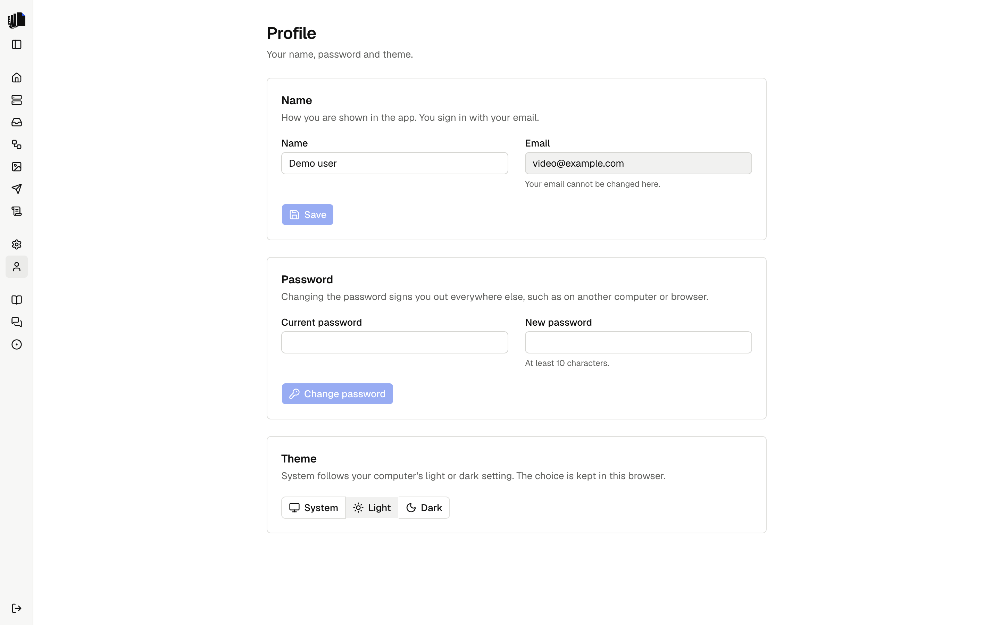

Profile, in the sidebar under Settings, holds what belongs to you rather
than to the whole app. Sign out is at the bottom of the sidebar.

  <picture>
    <source media="(prefers-color-scheme: dark)" srcset="assets/profile-dark.png">
    
  </picture>

## Name

The name is how you are shown in the app. Change it and select **Save**.
The email is the one you sign in with. It is shown, and cannot be changed
on this page.

## Password

Type the current password and a new one of at least 10 characters, then
select **Change password**. When it changes, every other session is
signed out, such as one on another computer or browser. The session you
are in stays signed in.

If the current password is wrong or the new one is too short, the page
says so and nothing changes.

## Theme

Pick **System**, **Light** or **Dark**. The choice applies at once and is
kept in this browser. System follows the light or dark setting of your
computer.
