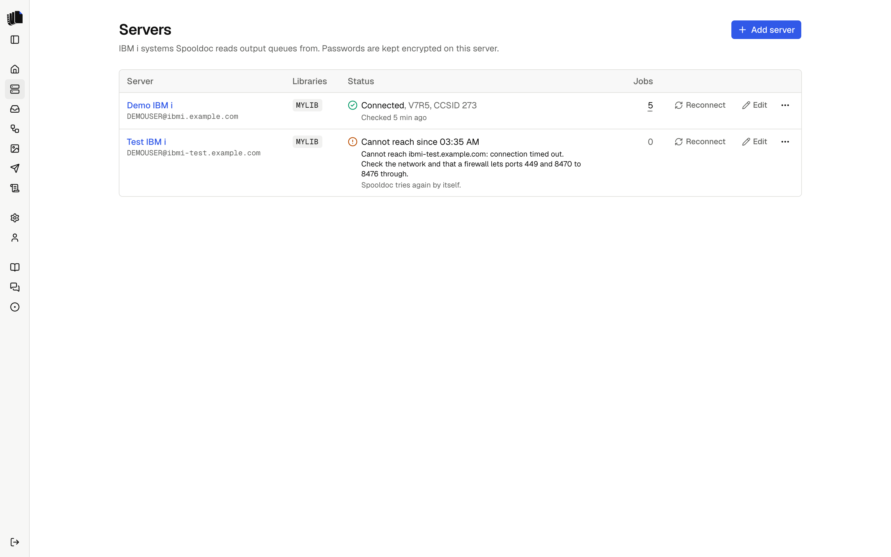

The Servers page lists the IBM i systems Spooldoc connects to. Each server
has a name, a host, a user profile and its password, and optionally the
libraries to list output queues from.

Click a server, or its name, to open its output queues on the Queues page.
Reconnect and Edit sit on each row. The ⋯ menu at the end of the row has
Reconnect, Edit and Delete.

The Jobs column counts the [jobs](jobs.md) that read from any output queue
of the server. Hover over the count, or click, tap or press Enter on it, to
list them, each with a link to the job and its state, as on the
[Queues](queues.md) page.

  <picture>
    <source media="(prefers-color-scheme: dark)" srcset="assets/servers-dark.png">
    
  </picture>

## Adding a server

| Field | What it is |
|-------|------------|
| Name | How the server appears in Spooldoc, for example `Production`. |
| Host | The host name or address of the IBM i. When `SPOOLDOC_ALLOWED_HOSTS` is set, this is a list of the allowed hosts instead of a free text field. |
| User profile | The profile Spooldoc signs on with. |
| Password | Stored encrypted with AES-256-GCM under `SPOOLDOC_SECRET_KEY`. When editing, leave it empty to keep the saved one; enter it again for a new host or user. |
| Libraries | Optional. Only the output queues of these libraries are listed. Empty lists every queue the profile can see. |

Spooldoc signs on when it saves a server, so a wrong host or password shows
up at once. When a server cannot be reached later, or its sign-on fails,
its status on the Servers page says so, and it appears under Needs
attention on the Home page. See [Connection status](#connection-status).

## Connection status

Every attempt to reach a server records its state: the pages, the queue
watcher and the runs. The Servers page shows it for each server, the
server pickers show its icon. With one server there is no picker, so the
Queues page shows the state in words instead.

| State | When | What happens next |
|-------|------|-------------------|
| Connected | The last attempt worked. Shows the OS version, the CCSID and when it was checked. | Normal use. |
| Not checked | Spooldoc has not signed on since the server was added. | The first use signs on. |
| Connecting... | Reconnect was pressed and the sign-on runs. | |
| Cannot reach | The host does not answer, the attempt timed out, or the connection dropped and trying again did not help. Shows since when and why. | Spooldoc tries again by itself. |
| Sign-on failed | The IBM i did not accept the user profile or password: a wrong or expired password, or a disabled profile. Shows since when and why. | Spooldoc does not sign on again until you edit the password or press Reconnect. |

An error about one output queue, spooled file or authority is about that
object, not the server, and does not change its state.

### When the connection drops

A connection can drop, for example when the network or a VPN changes.
Spooldoc then throws the connection away. A read, such as listing queues or
reading a spooled file, is tried once more at once on a new connection. A
change on the IBM i, such as holding, moving or deleting a spooled file, is
not tried again, since the IBM i may have done it already: the message
names the spooled file and asks you to check it.

When the server still cannot be reached, the queue watcher tries again
after 10 seconds, then waits twice as long each time, up to 2 minutes.
Once the server answers, its state goes back to Connected and the item
under Needs attention goes away. Spooldoc also turns on TCP keepalive, so a
dead connection is noticed sooner.

### Reconnect

Reconnect on the Servers page signs on to the server again from scratch,
not with the connection Spooldoc already has open, and shows the result.
The error box on the Queues page, on a queue's spooled files, on a spooled
file, in the job builder and under Needs attention offers Reconnect too
when the server cannot be reached or its sign-on failed. Once Reconnect
works, the page loads again.

Use it after you fix the cause, such as the network or the password on the
IBM i, to see at once whether it works. You do not need it after a network
problem that went away by itself.

### Why sign-on stops after a failed password

The IBM i disables a user profile after a number of failed sign-ons in a
row, set by the system value `QMAXSIGN`. If Spooldoc kept signing on with a
wrong password every few seconds, it would disable the profile. So after a
failed sign-on, Spooldoc does not sign on again by itself: the pages say
so, and the queue watcher leaves the server alone. Edit the password on the
Servers page, or press Reconnect once the password is fixed on the IBM i.

## What the profile needs

The profile needs to read the output queues of the jobs, and to hold, move
or delete the spooled files the finish step touches. Reading a spooled file
of another user needs `*SPLCTL` or the queue's authority, as it does with
`WRKOUTQ`. To set up real-time watching, the profile needs to create a data
queue and change the output queue (`CRTDTAQ`, `CHGOUTQ`). Nothing else is
needed: Spooldoc runs no SQL against application tables and installs
nothing on the IBM i.

## Network

Spooldoc connects through jt400 to the host server ports: 449 (port
mapper) and 8470 to 8476 (central, database on 8471, network print, remote
command and sign-on). See [Deployment](deployment.md#network).

## When the IBM i says no

Spooldoc reads the IBM i's error and says what went wrong and what to do
next, with the message ID at the end, such as `(CPF2204)`. The IBM i's own
text is under Details in the error box, for support. The same message
goes into the job log, Needs attention and the server log.

| What happens | What Spooldoc says to do |
|--------------|--------------------------|
| Wrong password (`CPF22E2`) | Check it on the Servers page. Repeated wrong passwords can disable the profile. |
| Profile disabled (`CPF22E3`) | A security officer enables it with `CHGUSRPRF USRPRF(name) STATUS(*ENABLED)`. |
| Password expired (`CPF22E4`) | Set a new one on the IBM i, then enter it on the Servers page. |
| No password (`CPF22E5`) | Use a user profile with a password. |
| No such user (`CPF2204`) | Check the user on the Servers page. |
| Unknown host, refused, timed out | Check the host name, that the host servers run (`STRHOSTSVR SERVER(*ALL)`), and the ports below. |
| Connection dropped (`08003`, `08S01`, connection reset) | Nothing, as a rule: Spooldoc connects again on the next try. If it keeps failing, check the network or VPN to the host. |
| No authority to an object | A security officer grants it, for example with `GRTOBJAUT ... AUT(*USE)` for the object named. |
| No authority to a spooled file | Other users' spooled files need `*SPLCTL`, or `*JOBCTL` on a queue created with `OPRCTL(*YES)`. |
| Output queue, library or data queue gone | Point the job's source at another queue, or turn on real-time watching again to create the data queue. |
| Spooled file gone | Nothing to fix: it was deleted, printed or cleaned up before Spooldoc read it. |

Errors Spooldoc does not recognize show the IBM i's text as it is.

## The data queue

A server remembers one data queue, the one Spooldoc reads for real-time
watching. It is either a queue Spooldoc created when asked (`SPOOLDOC` in
the output queue's library) or one that was there before, when you let
Spooldoc read a data queue an output queue already sent to. Spooldoc never
changes an output queue that sends to a data queue it does not read. See
[Watching a queue](jobs.md#watching-a-queue).

## Removing a server

A server that jobs still read from cannot be deleted; change or delete
those jobs first. Deleting the server removes its saved password and its
hidden-queue list.
