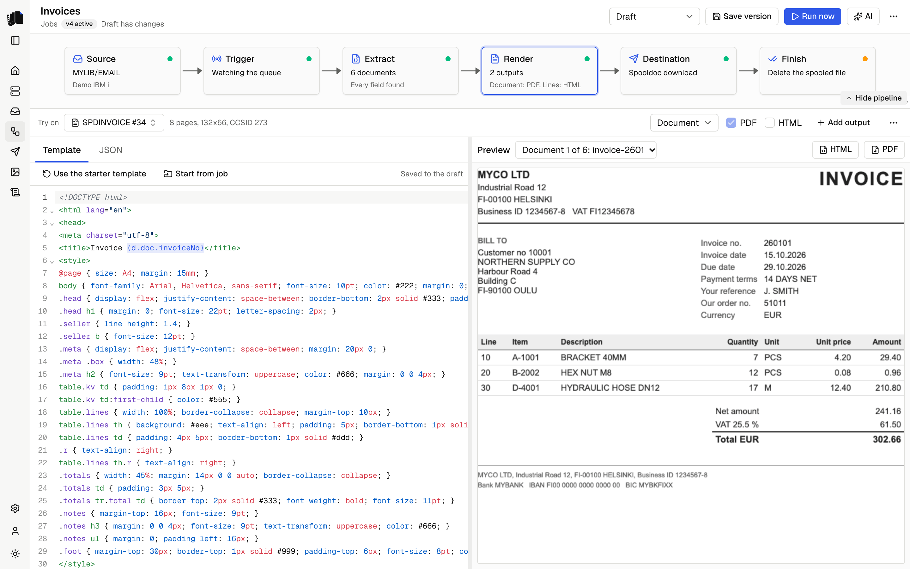

A template is an ordinary HTML page with [Carbone](https://carbone.io)
tags, such as `{d.doc.invoiceNo}`, or a Word document with the same tags
in its text (see [Word templates](#word-templates)). Each output of a job
has its own template. Each document the definition extracts is rendered
through it once, to the output's formats: an HTML template makes HTML
files, PDFs or both, and a Word template makes DOCX files, PDFs or both.
Until you write or upload one, the starter template renders the fields in
a header block and a table for each table, record or group. See
[Outputs](jobs.md#outputs).

Spooldoc renders every document with a Carbone server, your own or Carbone
Cloud. See [Carbone](carbone.md) to set one up.

<p align="center">
  <picture>
    <source media="(prefers-color-scheme: dark)" srcset="assets/template-preview-dark.png">
    
  </picture>
</p>

"Start from job" in the template editor's bar copies another job's
template, HTML or Word, into the output shown, and on request its
definition into the draft. When the other job has more than one output, pick the one to copy.
The [AI assistant](ai-assistant.md) does the same when asked.

## The data

A tag starts with `d`, the data of the document being rendered:

| Path | What it is |
|------|------------|
| `d.doc` | The document being rendered: the fields, tables, records and groups of the [definition](definitions.md). |
| `d.documents` | Every document of the spooled file, for page counts or totals. Sent only to templates that use it. |
| `d.sample.splf` | The spooled file: `name`, `number`, `jobName`, `jobUser`, `jobNumber`. |

```html
<h1>Invoice {d.doc.invoiceNo}</h1>
<p>{d.doc.customerName}<br>{d.doc.invoiceDate:formatD('DD.MM.YYYY')}</p>
<table>
  <tr><td>{d.doc.lines[i].item}</td><td class="num">{d.doc.lines[i].amount:formatN(2)} EUR</td></tr>
  <tr><td>{d.doc.lines[i+1]}</td></tr>
</table>
```

Values are HTML-escaped. A missing field renders as nothing.

## Loops

A row with `[i]` tags repeats for each item of a list. The row after it,
with an `[i+1]` tag, marks where the loop ends; Carbone removes it.

```html
<tbody>
  <tr><td>{d.doc.lines[i].line}</td><td>{d.doc.lines[i].item}</td></tr>
  <tr><td>{d.doc.lines[i+1]}</td></tr>
</tbody>
```

The same works for `<li>`, `<div>` or any other element. A loop without
its `[i+1]` row is an error.

## Conditions

`showBegin` and `showEnd` keep a part only when the condition holds:

```html
{d.doc.address2:ifNEM:showBegin}{d.doc.address2}<br>{d.doc.address2:showEnd}
{d.doc.type:ifEQ('C'):showBegin}<h2>Credit note</h2>{d.doc.type:showEnd}
```

`ifNEM` is "not empty"; `ifEM`, `ifEQ`, `ifNE`, `ifGT`, `ifGTE`, `ifLT` and
`ifLTE` work the same way. `hideBegin` and `hideEnd` do the opposite.

## Formatters

Formatters follow the path, each after a colon:

| Formatter | Example | Result |
|-----------|---------|--------|
| `formatN` | `{d.doc.total:formatN(2)}` | `1,234.50` |
| `formatD` | `{d.doc.invoiceDate:formatD('DD.MM.YYYY')}`, `{d.doc.invoiceDate:formatD('YYYY-MM-DD')}` | `01.10.2026`, `2026-10-01` |
| `padl`, `padr` | `{d.doc.no:padl(8)}`, `{d.doc.no:padr(8, '.')}` | Padded to eight characters on the left, or on the right with dots |
| `upperCase`, `lowerCase` | `{d.doc.city:upperCase}` | `HELSINKI` |

Numbers use English separators. Write a currency after the tag, as in
`{d.doc.total:formatN(2)} EUR`, or from the data:
`{d.doc.total:formatN(2)} {d.doc.currency}`. `formatN` without a number
shows three decimals.

Inside a tag, quote text with straight single quotes. Carbone prints
double quotes and curly quotes as text, so the check below refuses them.

Carbone has many more formatters, loops with filters and sorting, and
aliases. See [Carbone's documentation](https://carbone.io/documentation/design/overview/getting-started.html).
Some of them, such as aggregators (`:aggSum`), `:drop` and `:barcode`, need
Carbone Enterprise. See [Community and Enterprise](carbone.md#community-and-enterprise).

## The check before each render

Carbone renders some mistakes without an error: it prints nothing for a
field that is not in the data, and prints quotes it does not accept. So
Spooldoc checks each template before it renders, and the Template tab
lists each problem with its line (for a Word template, with its part:
body, header or footer):

- a tag whose field is not in the definition, such as `{d.doc.invoiceNumber}`,
  with the field it most likely means;
- double quotes or curly quotes inside a tag;
- Nunjucks left over, such as `{{ doc.x }}` or ``;
- a tag that is never closed;
- an asset name that is not uploaded.

A template with problems is not rendered, in the preview or in a run.
Carbone's own errors, such as a loop without an `[i+1]` row or a
formatter it does not have, show with Spooldoc's message on top and
Carbone's text under Details.

## Templates from before Carbone

Spooldoc 0.2 and older used [Nunjucks](https://mozilla.github.io/nunjucks/)
tags. A Nunjucks template is converted to Carbone tags when Spooldoc reads
it, for the common cases:

| Nunjucks | Carbone |
|----------|---------|
| `{{ doc.invoiceNo }}` | `{d.doc.invoiceNo}` |
| `<tr>...</tr>` | an `[i]` row and an `[i+1]` row |
| `......` | `showBegin` and `showEnd` |
| `money`, `money("EUR")` | `:formatN(2)`, followed by ` EUR` |
| `date`, `date("yyyy-MM-dd")` | `:formatD('DD.MM.YYYY')`, `:formatD('YYYY-MM-DD')` |
| `pad(8)`, `pad(8, "right", ".")` | `:padl(8)`, `:padr(8, '.')` |
| `upper`, `lower` | `:upperCase`, `:lowerCase` |
| `asset('logo')` | `{asset('logo')}` |
| `{# note #}` | `<!-- note -->` |

Anything the converter can't map stays as it was, and the check lists its
lines: a loop over more than one element, `elif`, `and` and `or`, `set`,
`loop.index`, and other filters. Fix those by hand. A job's draft keeps
the converted template once you save it.

## Word templates

An output can use a Word document as its template instead: you lay it out
in Word, with Word's own styles, headers and footers, and type the tags
into its text. It makes DOCX files, PDFs or both. Pick Word template in
the render step's header.

Until you upload one, the preview uses a Word starter template made from
the definition, with the same layout as the HTML one and "Page 1 of 2" in
the footer. To make your own:

1. Choose Download starter template in the Template tab.
2. Open it in Word. Turn off smart quotes first (see below), then change
   the layout, add a logo and move the tags where you want them.
3. Choose Upload template and pick the `.docx`.

Each upload is kept as its own file, and the draft points at the newest
one. A saved version keeps the file it was saved with, so uploading again
changes only the draft. Download template gives the uploaded file back.
Spooldoc takes `.docx` files up to 10 MB; it refuses a Word 97-2003
`.doc` and says to save it as a Word Document.

The [AI assistant](ai-assistant.md#word-templates) can design a Word
template for you, or change yours. Each change is a new file, and the
Word panel offers your earlier file back.

### Tags in Word

- **Turn off smart quotes before you type tags.** Word turns `'` into a
  curly quote by default, and Carbone prints a tag with curly quotes as
  text. In Word: File, Options, Proofing, AutoCorrect Options, AutoFormat
  As You Type, then clear "Straight quotes" with "smart quotes". On a Mac:
  Word, Preferences, AutoCorrect, AutoFormat As You Type. The check finds
  a tag with curly quotes.
- **The tags are the ones HTML templates use**, such as
  `{d.doc.invoiceDate:formatD('DD.MM.YYYY')}`. Word splits a tag into
  several pieces when part of it is styled or typed later; Spooldoc and
  Carbone read each paragraph as one text, so that is fine. A tag cannot
  go across two paragraphs.
- **Repeat a table row** with a row of `[i]` tags and, below it, a row
  with `{d.doc.lines[i+1]}` in its first cell, as in HTML. Keep a loop
  inside one part: the body, a header or a footer.
- **An optional line** is hidden with its line break when its field is
  empty: `{d.doc.address1}{d.doc.address2:ifEM:hideBegin}`, then a line
  break (Shift+Enter), then `{d.doc.address2}{d.doc.address2:hideEnd}`.
  The starter template writes its fields this way.
- **Pictures**, such as a logo, are inserted in Word and are the same in
  every document. Set each to In line with text (Picture Format, Wrap
  Text), so it stays in place. `{asset('name')}` is for HTML templates
  only; the check reports it in a Word template.

### Page numbers and fields

Insert page numbers with Insert, Page Number, or the PAGE and NUMPAGES
fields. In a DOCX file, Word fills them in when it opens the file. In the
PDF, Carbone's own converter prints them at the document's default font
size, not the size of the text around them in the footer.

The PDF of a template with cross-references (PAGEREF or REF fields) is
made with LibreOffice instead, which works them out itself. Tables of
contents have not been tested: check the PDF before you rely on one.

### Word templates by the assistant

The assistant designs a Word template as data in the shape of the
[docx](https://docx.js.org) library's options, and Spooldoc builds the
file with these parts of the library only:

| Part | What it can set |
|------|-----------------|
| The document | Named paragraph styles, the default font and spacing, the title and heading styles, different headers and footers on even pages. |
| A section | Page size and orientation (A4 unless set), margins, a different first page, headers and footers. |
| `Paragraph` | Text, a style or heading, a bullet, alignment, spacing, indents, borders, shading, tab stops, keep with next, keep lines together, a page break before. |
| `TextRun` | Font, size, colour, bold, italics, underline, caps, small caps, letter spacing, superscript, subscript, highlight, shading, line breaks. |
| `Tab`, `PageNumber` | A tab, and the PAGE and NUMPAGES fields, written the way Word writes them so the PDF prints them. |
| `Table`, `TableRow`, `TableCell` | Widths, column widths, fixed layout, alignment, borders, cell padding, shading, vertical alignment, cells across columns and rows, header rows repeated on each page, rows kept on one page. |
| `ImageRun` | A PNG or JPEG uploaded under Assets, by name, with a size in pixels. |

Anything else in a design is refused with where it is, and nothing is
saved. The tags, loops and optional lines are the ones in
[Tags in Word](#tags-in-word).

## Logos, images and fonts

This section is about HTML templates. In a Word template, insert the
picture in Word (see [Word templates](#word-templates)).

Templates cannot fetch anything, so an `` may stay
empty. Upload the file on the Assets page instead and print it with
`{asset('name')}`, which Spooldoc writes into the template as a data URI
before it sends it to Carbone:

```html

<style>
  @font-face { font-family: "Brand"; src: url("{asset('brand-font')}"); }
  body { font-family: "Brand", sans-serif; }
</style>
```

An asset is an image (PNG, JPEG, GIF, WebP, SVG) or a font (WOFF2, WOFF,
TTF, OTF) of at most 5 MB, named with lowercase letters, digits, dashes
and underscores. The bytes decide the type, not the file name. Every
render carries the asset as base64, so keep logos and fonts small. The
Assets page shows which jobs print each asset, and an unknown name is a
problem the check reports. The fonts the Carbone container has depend on
its image; the `full-...-fonts` image in the Compose file has a wide set.

## PDF layout

A Word template's PDF has the page size, margins, headers and footers set
in Word. The rest of this section is about HTML templates.

PDFs are printed on A4 by Carbone's Chromium converter: portrait, or
landscape when the spooled file is wider than 160 columns. A template's
own `@page { size: ...; margin: ... }` wins. Backgrounds and borders
print. Use `page-break-inside: avoid` on rows and `page-break-before:
always` between sections as you would for any print stylesheet.

For a header and footer on every page, with page numbers, use Carbone's
`<carbone-pdf-header>` and `<carbone-pdf-footer>` elements. They print in
the PDF only: Spooldoc hides them in HTML output.

```html
<carbone-pdf-footer>
  <div style="font-size: 8pt; width: 100%; text-align: center">
    Invoice {d.doc.invoiceNo}, page <span class="pageNumber"></span> of <span class="totalPages"></span>
  </div>
</carbone-pdf-footer>
```

## Files

Each document becomes a file named after the definition's `output.name`,
such as `invoice-260102.pdf`, `invoice-260102.html` or
`invoice-260102.docx`, or after the
spooled file and a number when there is no name. The files of every
output but the first add the output's name: `invoice-260102-lines.pdf`
for an output named Lines. See [Destinations](destinations.md).

A template with problems fails the run, and the error names the output
and the lines: `The "Lines" output's template has 1 problem. Line 12: ...`,
or for a Word template the parts: `... has 1 problem. Body: ...`. A Word
template whose file is gone fails the run and says to upload it again.
An error from Carbone names the output and the document.
